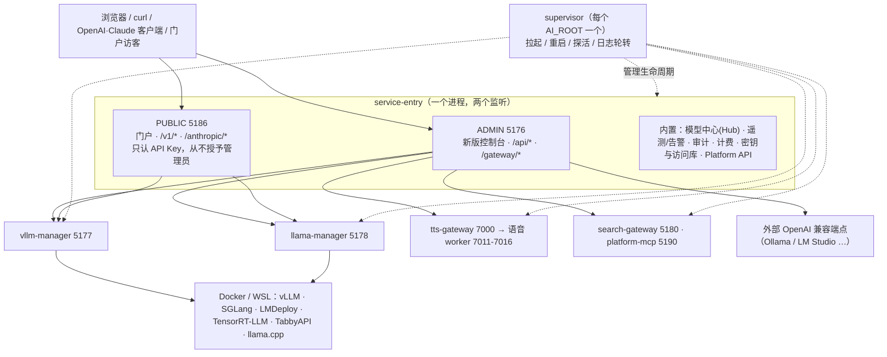
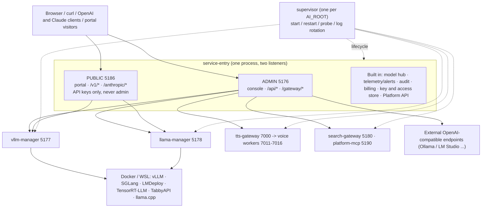

# Local Model Service Platform / 本地模型服务平台

一个面向高端个人工作站和小团队局域网的本地 AI 服务平台：用 Docker 运行 vLLM、SGLang、llama.cpp 等引擎，通过统一入口提供 OpenAI / Claude / OpenCode 兼容接口，并整合模型下载与库管理、显存估算与准入、遥测告警、审计计费、TTS 语音、联网搜索和 MCP。

A local AI serving platform for high-end personal workstations and small LAN teams: it runs vLLM, SGLang, llama.cpp and more in Docker, serves OpenAI / Claude / OpenCode compatible APIs through one entry point, and bundles model download and library management, VRAM estimation and admission, telemetry and alerts, audit and billing, TTS, web search and MCP.

**[中文说明](#中文说明) · [English](#english)**

---

## 中文说明

> 约定：文中 `<AI_ROOT>` 指平台根目录（环境变量 `AI_ROOT`，未设置时就是本仓库/发布包的根目录）；`<局域网 IP>` 指本机在局域网里的地址。所有命令默认在 `<AI_ROOT>` 下的 `cmd` 或 PowerShell 中运行。

### 目录

1. [概览](#1-概览)
2. [功能一览](#2-功能一览)
3. [系统要求](#3-系统要求)
4. [安装](#4-安装)
5. [快速开始](#5-快速开始)
6. [日常使用](#6-日常使用)
7. [命令行 platform CLI](#7-命令行-platform-cli)
8. [端口与地址](#8-端口与地址)
9. [配置](#9-配置)
10. [访问与安全](#10-访问与安全)
11. [对外服务](#11-对外服务)
12. [引擎与模型](#12-引擎与模型)
13. [监控与审计](#13-监控与审计)
14. [运维](#14-运维)
15. [开发与测试](#15-开发与测试)
16. [从旧版本升级](#16-从旧版本升级)
17. [目录结构](#17-目录结构)

### 1. 概览

这是一套运行在 Windows 上的本地 AI 服务平台，面向高端个人工作站和小团队局域网：在本机用 Docker（Docker Desktop 或 WSL 里的 Docker）运行 vLLM、SGLang、llama.cpp 等推理引擎，用一个统一入口对外提供 OpenAI / Anthropic(Claude) / OpenCode 兼容接口，并配套模型下载与库管理、显存估算与准入、遥测与告警、审计、计费、语音合成（TTS）、联网搜索和只读 MCP。

整体结构：



要点：

- **service-entry 是唯一的策略点**：Host/Origin 校验、API Key 鉴权、限流、计量都在入口完成，再用签名请求头把真实客户端信息传给管理器；管理器只信任带有效签名的回环请求。
- **两个监听严格分开**：ADMIN（默认 `127.0.0.1:5176`）提供控制台、`/api/*` 和本机/局域网网关；PUBLIC（默认 `127.0.0.1:5186`）只提供门户和需要 Key 的公开 API，是反向代理/隧道的唯一目标。
- **模型中心（Hub）在入口里**：下载队列、模型库、存储根、迁移都由入口负责，重启管理器不会中断下载。
- **supervisor** 是每个 `<AI_ROOT>` 的单例进程，负责按依赖顺序拉起组件、失败重启、探活和日志轮转；`platform` 命令行通过命名管道与它通信。
- 引擎、配方（recipe）、启动参数、知识库都是数据文件，可以在 `<AI_ROOT>/config/` 下覆盖，不用改代码。

### 2. 功能一览

- **统一控制台**：总览、部署、模型、引擎、Playground、观测、审计、告警、访问与密钥、计费、语音、系统；中英文界面、浅色/深色/自动主题、命令面板（`Ctrl/Cmd+K`）、通知中心。
- **多引擎**：vLLM、SGLang、llama.cpp 为稳定引擎；LMDeploy、TensorRT-LLM、TabbyAPI 为实验引擎；外部 OpenAI 兼容端点（Ollama、LM Studio 等）直接接入；可用 JSON 描述符定义自己的 Docker 引擎。
- **部署向导与启动计划**：7 步向导，每一步都先出“启动计划”（不产生副作用），显示每个值的来源、警告、阻断项和显存评估；计划与实际启动由同一个解析器生成。
- **显存估算与准入**：启动前估算权重、KV cache、激活；启动时申请 GPU 准入租约；实测值回灌校准。
- **配方**：内置 21 个配方（11 个模型配方、10 个场景配方），可把成功的启动“另存为配方”；闲置自动卸载与按需唤醒。
- **模型中心**：Hugging Face / hf-mirror / ModelScope 搜索与下载队列，多存储根、模型迁移、完整性校验、版本更新检查，下载后可直接部署。
- **模型体检**：模型卡（ModelCard）、兼容矩阵、无 GPU 的干跑探测、自动资格检查（qualify）、可分层覆盖的知识库。
- **对外服务**：平台 API Key（预设、范围、限流、配额、来源限制）、公开 API（`/v1`、`/anthropic/v1`）、公共门户、Cloudflare 隧道/Caddy 模板、暴露面扫描。
- **观测**：请求/运行时/GPU/能耗遥测（SQLite）、三档汇总、16 种告警指标、站内/Windows 通知/Webhook（飞书、钉钉、企业微信、Slack、通用）。
- **审计**：OpenWebUI 对话审计导出与索引，哈希链访问日志，定时导出与保留策略。
- **计费**：本机计费中心（客户、凭据、套餐、价格、用量、账本），可先“影子”运行再强制。
- **TTS 语音平台**：Chatterbox、Qwen3-TTS、Fish、Step-Audio、VoxCPM、Qwen VoiceDesign 以及外部 API 引擎，OpenAI Audio 兼容接口。
- **联网搜索与 MCP**：search-gateway（SearXNG 后端，带安全页面/PDF 读取）；platform-mcp 只读 MCP（19 个工具，Streamable HTTP 与 stdio）。
- **运维**：`platform` 命令行、体检（doctor）、首次运行向导、开机自启、部署/更新/备份/夜间自检、密钥库（Windows DPAPI）。

### 3. 系统要求

| 项 | 要求 |
| --- | --- |
| 操作系统 | Windows 10/11 |
| Node.js | `^22.22.2 \|\| ^24.15.0 \|\| >=26.0.0`（23、25 不支持），并需要内置的 `node:sqlite`；`platform` 启动前会检查，不符合时以退出码 5 拒绝启动；`PATH` 里没有 `node` 时 `platform.cmd` 报错并以 9009 退出（可用 `NODE_EXE` 指定 node 路径） |
| Docker | Docker Desktop（WSL 2 后端）；也可让平台在指定 WSL 发行版里运行 docker（`docker.wslDistro`） |
| GPU | NVIDIA 驱动与可用 GPU（运行 vLLM / SGLang / llama.cpp 的 CUDA 容器） |
| git | 使用 worktree 部署、`update-platform` 更新时需要 |
| Python 3.10+ | 可选；仅用于模型下载专用环境（`install-download-cli`） |
| Python 3.12 + `uv` + PowerShell 7 | 可选；仅 TTS 需要 |
| Chrome 或 Edge | 仅开发测试（Playwright 烟测），可设 `PLAYWRIGHT_BROWSER_CHANNEL=msedge` |

根目录 `package.json` 是私有包，开发依赖（Playwright、axe-core）只用于测试。

### 4. 安装

在 `<AI_ROOT>` 根目录运行：

```cmd
install-all
install-download-cli
```

- `install-all.cmd`：在根目录、`vllm-manager`、`llama-manager`、`platform-mcp`、`search-gateway` 里运行 `npm ci`（没有 `package-lock.json` 时用 `npm install`），然后构建 `platform-mcp`（`tsc`），最后执行 `platform deps --record` 记录依赖状态。`service-entry` 和 `manager-core` 没有额外的安装步骤。
- `install-download-cli.cmd`：创建专用虚拟环境 `<AI_ROOT>\venvs\download-cli`（需要 Python 3.10+，可用 `-PythonExe` 指定），安装 `scripts/requirements-download.txt` 里固定版本的 `huggingface_hub` / `modelscope`，并自检；完成后需要重启两个管理器。模型下载依赖其中的 `hf` 与 `modelscope` 命令。
- TTS（可选）：`install-tts-gateway.cmd` 用 `uv` 在 `<TTS_RUNTIME_ROOT>\envs\gateway` 创建 Python 3.12 网关环境（`TTS_RUNTIME_ROOT` 默认 `<AI_ROOT>\tts-runtime`）；各语音引擎的 worker 环境由 `tts-platform/scripts/install_model.ps1` 单独安装，详见 `tts-platform/README.md`。未安装网关环境时，`platform start full` 会跳过 TTS 网关。

### 5. 快速开始

1. 安装见上一节。
2. 运行首次向导（可选，但推荐）：

   ```cmd
   platform setup
   ```

   向导按顺序检查：`prereq`（环境）→ `deps`（依赖）→ `download-cli`（可选）→ `storage`（模型目录/HF 缓存）→ `images`（预拉取运行时镜像，默认 vLLM）→ `tts`（可选）→ `exposure`（仅本机或局域网）→ `ops`（可选的自启/备份命令）→ `start`（启动 core）→ `first-model`（可选）。已经满足的步骤显示为完成，任何一步都可用 `platform setup --step <id>` 重做；进度保存在 `<AI_ROOT>\.runtime\platform\setup.json`。新版控制台的 `/setup` 页提供同一套步骤，也可跳过。非交互用法：`--yes --non-interactive --engines vllm,llama --model-root <目录> --hf-home <目录> --exposure local|lan`。
3. 启动：

   ```cmd
   platform start
   ```

   默认启动 `core`（Docker 检查、入口、vLLM 管理器、llama 管理器），入口就绪后自动打开浏览器（`cli.openBrowser`，可用 `--no-browser` 关闭）。需要局域网设备访问加 `--lan`；`platform start full`（或 `all`）再加 platform-mcp、TTS 网关和搜索网关。
4. 打开控制台：`http://127.0.0.1:5176/`。本机访问不需要配对，直接就是管理员。
5. 部署第一个模型（任选其一）：
   - **下载**：控制台 → 模型 → 发现，搜索并选择文件，确认下载计划；勾选“下载后部署”即可在下载完成后自动规划启动。
   - **本地已有模型**：把模型目录放进 `<AI_ROOT>\models`（或在 模型 → 存储 注册其它目录），在 模型 → 本地库 点“部署”。
   - 然后进入部署向导（见下一节），启动后在 Playground 里试聊，或把客户端指向网关地址。
6. 检查与停止：`platform status`、`platform doctor`、`platform stop`。

### 6. 日常使用

#### 控制台页面

| 页面 | 路径 | 用途 |
| --- | --- | --- |
| 总览 | `/overview` | 就绪状态、需要关注的事项、运行中的部署、近期活动 |
| 部署 | `/deployments` | 所有实例（状态、引擎、端口、上下文、显存、tok/s）；`/deployments/new` 向导；`/deployments/routing` 路由模式与显存策略；实例详情含指标/日志/配置/请求/事件，可“认证此部署”和“另存为配方” |
| 模型 | `/models` | 本地库、`/models/discover` 搜索、`/models/downloads` 下载队列、`/models/storage` 存储与迁移、`/models/knowledge` 知识库 |
| 引擎 | `/engines` | 引擎卡片、运行时镜像、`/engines/external` 外部端点、`/engines/new` 自定义 Docker 引擎描述符生成器 |
| Playground | `/playground` | 多轮对话测试台（流式，转录只保存在内存） |
| 观测 | `/observability` | 概览、性能（TTFT）、流量、错误、GPU、模型生命周期、请求明细与设置 |
| 审计 | `/audit` | 时间线、对话、导出链、访问日志、设置（读内容需要审计解锁） |
| 告警 | `/alerts` | 触发中、历史、规则、通知渠道 |
| 访问与密钥 | `/access` | API Key、客户端接入指南、公网访问向导、安全概览、门户内容、已配对浏览器 |
| 计费 | `/billing` | 客户、凭据、套餐、价格、用量、账本、审计 |
| 语音 | `/voice` | 每个 TTS 引擎一张卡片，加载/卸载/停止 |
| 系统 | `/system` | 组件状态、`/system/doctor` 体检、`/system/settings` 配置、`/system/updates` 版本与待重启、`/system/ops` 运维计划、`/system/preferences` 偏好 |
| 首次向导 | `/setup` | 同 `platform setup` |

`/classic` 已退役，会跳转到 `/overview`。仍可用 `http://127.0.0.1:5176/?ui=classic` 临时查看经典界面，或设 `SERVICE_ENTRY_CONSOLE_DEFAULT=classic` / `console.defaultUi=classic` 让根地址默认显示经典界面。

#### 部署一个模型（向导）

`/deployments/new` 共 7 步：模型 → 引擎 → 资源 → 能力 → 访问 → 复核 → 启动。每一步都会调用 `POST /api/m/<管理器>/launch/plan`，复核页显示完整的启动计划：

- 每个值带来源标记（`user` 你设置、`planner` 规划器、`recipe` 配方、`model` 模型配置、`platform-default` 平台默认）；
- 警告与阻断项（例如 `insufficient_vram`、`image_pull_required`、`recipe_blocked`、`instance_conflict`）；
- 命令（已脱敏）、显存估算与准入结论。

实例模式：`replace`（替换，旧容器改名保留作回滚点）、`parallel`（并行，新实例）、`add`（只追加，不动运行中的容器）。启动流水线依次为 排队 → 预检 → 计划 → 镜像 → 显存准入 → 重新规划 → 创建容器 → 等待就绪 → 生成自检（探测）→ 提交。向导支持快捷入口：`?model=<目录或 hf:owner/name[@rev]>&engine=&recipe=`、`?clone=<launchId>&manager=`、`?profile=<id>&manager=`。

#### 下载

- 来源：Hugging Face、hf-mirror、ModelScope；策略 `huggingface`（默认）/`hf-mirror`/`auto`（官方优先，网络类失败时单次降级到镜像）。受限（gated）仓库始终走官方端点。
- 令牌：下载时输入的 HF 令牌只保存在入口进程内存里，用完即弃；勾选“记住”才写入加密密钥库。也可 `platform secrets set hf.token`。镜像和 ModelScope 不会收到令牌。
- 队列：全局持久队列，状态含排队/等待/解析/下载/落盘/校验/就绪/重试/暂停/中断/失败/取消，可暂停、继续、重试、调整优先级、排序；入口重启后自动续传。默认单任务并发（`transfer.maxConcurrent`），下载停滞（10 分钟无进展）会终止进程但保留已下载文件并按策略重试，默认校验 sha256。
- 目标目录名默认是仓库名把 `/` 换成 `-`，可在计划里改；选择存储根即选择落点。

#### Playground 与语音

Playground 以管理员会话直接调用网关，不需要 Key；只有收到 401 或你想用指定 Key 测试时才出现 Key 输入框（只保存在内存）。语音页管理各 TTS 引擎的加载与卸载；TTS 网页工作台位于 `http://127.0.0.1:5176/gateway/tts/`。

### 7. 命令行 platform CLI

`platform.cmd` 是 `node scripts/platformctl.js` 的入口。全局选项：`--lang zh|en`（也可用 `PLATFORM_LANG`，否则按系统语言）、`--help`、`--json`（stdout 只输出一个 JSON 文档）。

| 命令 | 说明 |
| --- | --- |
| `platform start [core\|full\|all\|<id>...]` | 启动。选项：`--lan`（本次让控制台监听局域网）、`--public`（本次让公共监听监听局域网）、`--save`（把上述覆盖写入 `platform.json`）、`--restore-models`（恢复上次运行的模型）、`--no-supervisor`、`--no-browser`、`--open`、`--timeout <秒>`（默认 180）。启动前做预检（Node 版本、`node:sqlite`、配置错误、缺少 `node_modules`、缺少 platform-mcp 构建），失败退出码 5 |
| `platform stop [<id>...\|core\|full\|all]` | 按依赖逆序停止，默认目标 `full`。默认**不**停止模型容器；`--models` 先停止运行中的模型实例（需要输入 `stop` 确认，`--yes` 跳过）。`stop all` 同时让 supervisor 退出 |
| `platform restart <id...\|all>` | 重启。组件忙（有请求或下载）时：TTY 下询问，`--if-idle` 或非交互时退出码 3，`--when-idle` 排队到空闲再重启，`--force` 强制 |
| `platform status [<id>...] [--watch] [--json]` | 分层显示 环境/运行时/组件/服务/暴露面；没有 supervisor 时用探测模式；`--watch` 每 2 秒刷新 |
| `platform doctor [--deep] [--group env,runtime,storage] [--json]` | 体检，有失败项时退出码 1，结果写入 `.runtime/platform/doctor-last.json`。自动修复请在控制台 系统 → 体检 页执行（命令行 `--fix` 暂未接通） |
| `platform logs <id> [-f] [--err\|--out] [--tail N] [--since 10m\|2h\|1d] [--legacy]` | 查看组件日志（已脱敏，默认 `--tail 100`） |
| `platform open [console\|billing\|vllm\|llama\|tts] [--print]` | 打开页面 |
| `platform config list\|get\|set\|unset\|validate\|path\|init\|import-env` | 读写 `platform.json`；`set`/`unset` 会提示需要重启哪些组件；`import-env [--apply] [--remove-user-env]` 把用户环境变量迁入配置 |
| `platform secrets list\|set <key>\|clear <key>\|copy <key>\|migrate\|export-legacy` | 密钥库。值不会出现在命令行或屏幕上；`copy` 复制到剪贴板，如 `platform secrets copy platformMcp.apiKey` |
| `platform admin pair [--open] [--ttl 1-600]` | 生成一次性配对链接（仅在开启 `requirePairingOnLoopback` 或为其它设备配对时需要） |
| `platform keys migrate [--dry-run\|--report]` | 预览/查看旧版管理器 API Key 导入平台密钥库的情况（入口启动时会自动迁移） |
| `platform exposure scan` / `exposure setup` | 只读暴露面检查；`setup` 调用 `scripts/setup-public.ps1` 渲染 Caddy/cloudflared 模板 |
| `platform setup [--step id]` | 首次运行向导 |
| `platform autostart enable\|disable\|status` | 开机自启（见运维） |
| `platform supervisor status\|stop\|reexec` | 查看/停止/原地重启 supervisor；`platform supervise` 在前台运行它 |
| `platform deploy` / `update` / `post-deploy` | 部署与更新（见运维与开发） |
| `platform version [--fetch]` / `deps [--record\|--install <包>]` | 版本信息；依赖状态 |

退出码：`0` 成功，`1` 失败或组件未就绪，`2` 用法错误，`3` 因平台忙而拒绝，`4` supervisor 不可用，`5` 预检被阻止，`9009` 找不到 Node。

根目录的旧脚本继续可用，它们只是转调 `platform.cmd`：`start-platform.cmd [core|all] [lan]`、`stop-platform.cmd [all]`、`status-platform.cmd`、`start-service-entry.cmd [lan]`、`start-service-entry-lan.cmd`、`stop-service-entry.cmd`（只停入口和两个管理器）、`status-service-entry.cmd`、`start|stop|status-platform-mcp.cmd`、`start|stop-search-gateway.cmd`、`start-tts-platform.cmd [-GatewayOnly]`；`vllm-manager` 与 `llama-manager` 目录下各有 `start-manager.cmd` / `stop-manager.cmd`。`status-tts-platform.cmd` 直接运行 `tts-platform\scripts\status.ps1`（需要 PowerShell 7）。双击运行 `start-platform.cmd` 会在结尾暂停，设 `PLATFORM_NO_PAUSE=1` 可关闭。

### 8. 端口与地址

| 组件 | 默认地址 | 说明 |
| --- | --- | --- |
| 入口 ADMIN | `127.0.0.1:5176` | 控制台、`/api/*`、网关；`--lan` 时监听 `0.0.0.0`。配置 `listeners.admin.port`，环境变量 `SERVICE_ENTRY_PORT` |
| 入口 PUBLIC | `127.0.0.1:5186` | 门户与公开 API，隧道/Caddy 的唯一目标；健康检查 `/healthz`。配置 `listeners.public.*` |
| vllm-manager | `0.0.0.0:5177` | `managers.vllm.port`（`VLLM_MANAGER_PORT`）；管理页只接受本机 |
| llama-manager | `0.0.0.0:5178` | `managers.llama.port`（`LLAMA_MANAGER_PORT`） |
| search-gateway | `127.0.0.1:5180` | `search.port`；其 SearXNG 后端在 `127.0.0.1:8180` |
| platform-mcp | `127.0.0.1:5190` | `platformMcp.port`，仅回环；MCP 地址 `http://127.0.0.1:5190/mcp` |
| TTS 网关 | `127.0.0.1:7000` | `tts.gatewayPort`；worker：chatterbox 7011、qwen 7012、fish 7013、step 7014（Docker）、voxcpm 7015、qwen-design 7016 |
| vLLM 系引擎容器 | 8000 | 容器内服务端口（`VLLM_PORT`）；llama.cpp 为 8080 |
| 旧版 Claude 代理 | 8001 | 外部可选，`start-claude-vllm-proxy.ps1` |

健康检查：入口 `/gateway/health`，管理器 `/api/manager/health`，MCP `/health`，TTS `/health`，搜索 `/health`。

常用接口地址（本机；局域网把 `127.0.0.1` 换成 `<局域网 IP>`，并携带 API Key）：

```text
OpenAI:   http://127.0.0.1:5176/gateway/auto/openai/v1
Claude:   http://127.0.0.1:5176/gateway/auto/claude
OpenCode: http://127.0.0.1:5176/gateway/auto/opencode/v1
TTS UI:   http://127.0.0.1:5176/gateway/tts/
TTS API:  http://127.0.0.1:5176/gateway/tts/openai/v1
MCP:      http://127.0.0.1:5190/mcp
搜索:     http://127.0.0.1:5180/v1
公开 API: http://127.0.0.1:5186/v1   （PUBLIC 监听，必须带 Key）
```

`auto` 自动选择当前可用的后端；把 `auto` 换成 `vllm` 或 `llama` 可固定管理器，换成引擎 id（如 `sglang`）可指定引擎，`/gateway/external/<端点 id>/…` 走外部端点。客户端配置：OpenWebUI / OpenAI SDK 用 OpenAI 地址和 `Authorization: Bearer <API_KEY>`；Claude Desktop / Cowork / ccswitch 用 Claude 地址和 `ANTHROPIC_API_KEY`；OpenCode 用 OpenCode 地址，模型名优先 `local-current`。更多示例见 [客户端连接指南](docs/client-setup-guide.md)，控制台“访问 → 客户端”页也提供可复制的配置。平台 MCP（只读工具：搜索与研究、网页读取、任务历史、路由预览、显存估算、安全态势等；`PLATFORM_MCP_TOOL_PROFILE` 可选 `all`/`ops`/`web`）的 Bearer Key 存放在密钥库（`platform secrets copy platformMcp.apiKey`），本地 stdio 宿主可运行 `node platform-mcp\scripts\run-stdio.mjs`；Chatbox、OpenWebUI、Claude、Codex、IDE 的接入示例见 [自建平台级 MCP 接入指南](docs/mcp-platform-guide.md)。

### 9. 配置

#### platform.json

唯一的平台配置文件是 `<AI_ROOT>\config\platform.json`（`PLATFORM_CONFIG_FILE` 可指向别处）。它只保存与默认值不同的项，缺失即全部默认。**不要手改**：用 `platform config set <key> <value>`，或控制台 系统 → 设置（按 schema 生成的表单，每个值显示来源，标注需要重启的组件）。写入带文件锁和 etag 冲突检测，变更的键名（不含值）记入 `<AI_ROOT>\logs\platform\config-changes.jsonl`。密钥类配置项**不会**写入该文件。

优先级：**运行时覆盖（如 `--lan`）> 环境变量 > `platform.json` > 派生值 > 默认值**。无效的候选值会被跳过并报告错误，下一个来源接管；同一个键的多个环境变量别名取值不一致时取排在前面的并给出警告。

跨字段校验：端口不能冲突；“局域网可达 + `exposure.requireApiKey=off`”被拒绝（`insecure_combination`）。

#### 重要配置项

| 键 | 默认 | 环境变量 | 说明 |
| --- | --- | --- | --- |
| `listeners.admin.lan` | `false` | `SERVICE_ENTRY_ALLOW_LAN_ADMIN` | 控制台监听局域网（`--lan` 的持久形式） |
| `listeners.admin.port` | `5176` | `SERVICE_ENTRY_PORT` | 控制台端口 |
| `listeners.public.enabled` / `.port` / `.lan` | `true` / `5186` / `false` | `SERVICE_ENTRY_PUBLIC_LISTENER` / `SERVICE_ENTRY_PUBLIC_PORT` | 公共监听 |
| `listeners.public.baseUrl` | 空 | `SERVICE_ENTRY_PUBLIC_BASE_URL` | 隧道域名（https） |
| `admin.allowLanOwner` | `true` | `SERVICE_ENTRY_ALLOW_LAN_ADMIN=0` 关闭 | 控制台监听局域网时，局域网设备也是管理员 |
| `admin.requirePairingOnLoopback` | `false` | `SERVICE_ENTRY_REQUIRE_PAIRING` | 本机也必须配对 |
| `admin.extraHosts` | `[]` | | 允许打开控制台的额外 Host |
| `exposure.requireApiKey` | `auto` | `SERVICE_ENTRY_REQUIRE_API_KEY` | `auto`/`on`/`off`；`auto` = 局域网或公网模式要求 Key |
| `exposure.allowedOrigins` | `[]` | `SERVICE_ENTRY_ALLOWED_ORIGINS` | 浏览器 CORS 白名单 |
| `trustedProxies.cidrs` | `127.0.0.1/32`, `::1/128` | `SERVICE_ENTRY_TRUSTED_PROXIES` | 只有这些地址发来的转发头才被采信 |
| `managers.bindHost` | `0.0.0.0` | `VLLM_MANAGER_HOST` / `LLAMA_MANAGER_HOST` | 管理器监听地址 |
| `docker.ensureOnStart` | `start` | | `start` 启动 Docker Desktop 并等待、`wait` 只等待不启动、`off` 不等待 |
| `docker.waitTimeoutSec` / `docker.wslDistro` | `120` / 空 | `PLATFORM_DOCKER_WAIT_SECONDS` / `DOCKER_WSL_DISTRO` | 等待 Docker；在指定 WSL 发行版里运行 docker |
| `console.defaultUi` | 未设置时为新版控制台 | `SERVICE_ENTRY_CONSOLE_DEFAULT` | 设为 `classic` 回到经典界面 |
| `cli.openBrowser` / `cli.lang` | `true` / `auto` | `PLATFORM_LANG` | `platform start` 是否开浏览器；CLI 语言 |
| `paths.hfHome` | `${AI_ROOT}/cache/huggingface` | `HF_HOME` | Hugging Face 缓存 |
| `paths.ttsRuntimeRoot` | 空（`<AI_ROOT>\tts-runtime`） | `TTS_RUNTIME_ROOT` | TTS 运行时目录 |
| `hub.downloadsOwner` | `hub` | `AI_HUB_DOWNLOADS_OWNER` | `hub` 由入口负责下载；`manager` 为回退（管理器自己的旧下载控制器） |
| `models.autoQualify` | `first-launch` | `AI_MODELS_AUTO_QUALIFY` | 首次成功启动后自动资格检查；`off`/`always` |
| `public.managersGatewayOnly` | `warn` | `MANAGER_GATEWAY_ONLY` | 管理器如何处理没经过入口的模型请求：`off`/`warn`/`enforce` |
| `telemetry.enabled` | `true` | `TELEMETRY_ENABLED` | 遥测开关（保留期等见“监控与审计”） |
| `audit.schedule.*` | 开启，每 60 分钟增量，04:00 全量 | | 审计定时导出 |
| `supervisor.autostartProfile` | `core` | | 开机自启的档位 |
| `supervisor.restoreModels` | `offer` | | 启动后对恢复模型的处理：`off`/`offer`/`auto` |
| `supervisor.logs.maxBytes` / `.keep` | 20 MiB / 5 | | 日志轮转 |
| `doctor.minFreeGb.*` | AI 根 20、模型根 50、Docker 数据 30 | | 体检的磁盘余量阈值 |
| `updates.branch` | `main` | | `platform version` / `update --check` 比较的分支 |
| `platformMcp.port` / `toolProfile` | `5190` / `all` | `PLATFORM_MCP_PORT` / `PLATFORM_MCP_TOOL_PROFILE` | 工具档位 `all`/`ops`/`web` |
| `search.port` / `search.upstreamBaseUrl` | `5180` / 空（自动选择） | `SEARCH_GATEWAY_PORT` / `UPSTREAM_BASE_URL` | 搜索网关 |
| `components` | `{}` | | 按组件覆盖 autostart/档位/重启策略/额外环境变量（不得携带凭据） |

完整列表和中英文说明在 `manager-core/data/platform-config.schema.json` 与 `manager-core/data/platform-config.d/*.schema.json`，控制台设置页由它们生成。

#### 其它常用环境变量

| 变量 | 说明 |
| --- | --- |
| `AI_ROOT` | 平台根目录 |
| `VLLM_MODELS_ROOT` / `LLAMA_MODELS_ROOT` | 默认模型库目录（默认 `<AI_ROOT>\models`） |
| `VLLM_MANAGER_ALLOW_REMOTE` / `LLAMA_MANAGER_ALLOW_REMOTE` | `1` = 管理器的管理页和管理 API 也接受非本机请求（默认 `0`） |
| `SERVICE_ENTRY_DATA_DIR` | 入口数据目录（默认 `service-entry/data`，主要用于测试） |
| `AI_BILLING_DB` / `AI_TELEMETRY_DB` / `AI_AUDIT_ROOT` | 计费库、遥测库、审计根目录 |
| `MODEL_STORAGE_FILE` | 存储根注册文件 |
| `VLLM_IMAGE` / `VLLM_IMAGE_VERSION` / `SGLANG_IMAGE` / `LLAMA_IMAGE` 等 | 覆盖运行时镜像（见“引擎与模型”） |
| `MODEL_GPU_ADMISSION_RESERVE_MB` / `_MAX_UTILIZATION_PCT` / `_STARTUP_MARGIN_MB` | GPU 准入默认值 |
| `MANAGER_STATUS_CACHE_MS`（2000）/ `STATS_SAMPLE_INTERVAL_MS`（10000，5000–60000） | 管理器状态缓存与统计采样 |
| `MODEL_ACCESS_STATS_CACHE_MS` / `MODEL_REMOTE_SEARCH_CACHE_MS` / `MODEL_REMOTE_INFO_CACHE_MS` / `METRICS_HISTORY_FLUSH_MS` | 访问统计、在线搜索、模型信息缓存与指标落盘间隔 |
| `SERVICE_ENTRY_AUTH_FAIL_LIMIT` / `_WINDOW_SECONDS` / `_BAN_SECONDS` | 鉴权失败封禁（默认 20 次/60 秒 → 封 600 秒） |
| `SERVICE_ENTRY_ALLOWED_HOSTS` | PUBLIC 额外 Host 白名单 |
| `SEARCH_GATEWAY_API_KEY` / `SEARCH_GATEWAY_ALLOW_NO_KEY` | 搜索网关的 Key；无 Key 且非回环时需显式允许 |
| `AI_AUDIT_MAX_EXPORTS` / `AI_AUDIT_MAX_AGE_DAYS` | 审计导出保留份数（30）与天数（90） |
| `PLAYWRIGHT_BROWSER_CHANNEL` | 烟测浏览器通道（如 `msedge`） |

#### 数据、日志与密钥位置

| 位置 | 内容 |
| --- | --- |
| `<AI_ROOT>\config\` | `platform.json`；可选覆盖：`engines\*.json`、`recipes\*.json`、`launch-params\*.json`、`knowledge.d\`、`runtime-manifest.json`、`public\`（隧道/Caddy 渲染结果） |
| `<AI_ROOT>\.runtime\` | `secrets\`（DPAPI 密钥库）、`platform\`（setup.json、doctor-last.json、状态）、`platform-mcp\`、`engine-flags\`、`gpu-admission\` 等运行态，不要提交 |
| `<AI_ROOT>\logs\<组件 id>\` | 组件 stdout/stderr（`<id>.out.log` / `<id>.err.log`），每次启动轮转，保留 5 份，运行中超过 20 MiB 也会截断；`logs\platform\` 是 supervisor 日志与配置变更记录 |
| `service-entry\data\` | 平台访问库 `platform-access.sqlite`、计费库 `platform-billing.sqlite`、遥测 `telemetry.sqlite`、`model-storage.json`、`hub\`（下载队列、库、设置）、`model-migrations\` |
| `vllm-manager\logs`、`llama-manager\logs` | 各管理器的账本、统计、启动记录（`launch-store.json`）、闲置卸载状态等 |
| `<AI_ROOT>\models`、`cache\`、`audit-logs\`、`tts-runtime\`、`backups\` | 默认模型库、缓存、审计导出、TTS 运行时、每日备份（都不进 Git 与发布包） |

密钥只存在 `<AI_ROOT>\.runtime\secrets\<命名空间>.json`，每个值用 Windows DPAPI（当前用户）加密，文件带仅所有者 ACL；密钥只通过环境变量传给子进程，不出现在命令行、`platform.json` 或日志里（日志统一脱敏为 `<redacted>`）。多存储根、迁移与容器路径映射见 [模型存储指南](docs/model-storage-guide.md)。

### 10. 访问与安全

#### 默认行为

- **本机即管理员**：来自本机的请求（按 socket 地址判断，转发头不算）直接是管理员，不需要配对或会话；新版控制台和经典页面都直接以管理员打开。`curl`、`platformctl`、PowerShell 等不带 `Origin` 的脚本可直接写入。
- **局域网**：入口以局域网模式启动（`platform start --lan`，或 `listeners.admin.lan=true`）时，局域网设备默认也是管理员（`admin.allowLanOwner=true`）。局域网设备访问模型网关仍需要 API Key。
- **浏览器写请求必须同源**：带 `Origin` / `Sec-Fetch-Site` 的写请求必须与控制台同源，否则返回 `csrf_invalid`。
- **永远不是管理员**：带转发头的请求（`X-Forwarded-*`、`CF-Connecting-IP` 等）和公共监听（5186）上的任何请求。转发头只能降级，不能提权。
- **管理器**默认监听 `0.0.0.0`（便于 Docker 容器经 `host.docker.internal` 回连），但它们的管理页和管理 API 默认只接受本机，其它设备只能走入口网关；通过 `platform` 启动时这个监听地址由配置注入，手工直接运行 `server.js` 则只监听 `127.0.0.1`。
- 模型网关：本机控制台会话不需要 Key；非本机调用者需要 API Key（`exposure.requireApiKey=auto` 时，局域网或公网模式强制）；PUBLIC 与经转发的请求始终需要 Key。Key 可放在 `Authorization: Bearer`、`x-api-key`、`api-key`、`anthropic-api-key`。
- ADMIN 的 Host 白名单是 `127.0.0.1`、`localhost`、`::1`、（局域网模式下的）本机局域网地址和 `admin.extraHosts`，其它返回 `host_not_allowed`；浏览器跨域默认拒绝。

> **警告**：局域网模式下，同一网段的任何设备都能在不配对的情况下管理你的平台（启停管理器、读写配置、创建 Key、停止模型）。在咖啡厅、宿舍、办公室等不可信网络上，不要使用 `--lan`，或先把 `admin.allowLanOwner` 设为 `false`。

#### 收紧开关

| 目标 | 设置 |
| --- | --- |
| 局域网设备只读（状态脱敏） | `platform config set admin.allowLanOwner false`，或环境变量 `SERVICE_ENTRY_ALLOW_LAN_ADMIN=0` |
| 本机也必须先配对 | `platform config set admin.requirePairingOnLoopback true`，或 `SERVICE_ENTRY_REQUIRE_PAIRING=1`；用 `platform admin pair --open` 打开已配对的浏览器 |
| 管理器只监听本机 | `platform config set managers.bindHost 127.0.0.1` |
| 管理器只接受入口转发的模型请求 | `platform config set public.managersGatewayOnly enforce`（先用默认 `warn` 观察日志里的 `direct_manager_gateway` 事件降到零） |
| 模型网关一律要 Key | `platform config set exposure.requireApiKey on` |
| 关闭公共监听 | `platform config set listeners.public.enabled false` |
| 放行浏览器跨域 | `SERVICE_ENTRY_ALLOWED_ORIGINS=https://a.example,https://b.example`（`*` 会被体检标为失败） |
| 额外的 Host / 反向代理域名 | ADMIN 用 `admin.extraHosts`；PUBLIC 用 `SERVICE_ENTRY_ALLOWED_HOSTS` |
| 防火墙 | 不需要其它设备直连管理器时，在 Windows 防火墙阻止 5177/5178 入站；5180、5190、7000、8000、8080 也应保持对外关闭 |

要求配对时：会话 cookie `lai_admin` 默认有效 180 天；一次性配对码默认 120 秒有效，回环生成的码不能在局域网兑换；也可用管理令牌（`Authorization: Bearer pat_…`）。

#### 其它保护

- 鉴权失败防护：同一来源 60 秒内失败 20 次则封禁 600 秒（逐步升级，上限 24 小时）；本机直连与可信代理永不被封。PUBLIC 另有按 IP 的预鉴权限流（每分钟 120，突发 30）。
- 访问统计与遥测只记录元数据（来源 IP、路径、状态码、模型名、token 数、耗时），不记录提示词或响应正文；密钥、会话、配对码只存 sha256 哈希。
- 旧版本曾可能把模型运行时 Key 明文写进任务账本：新版读写账本时都会替换为 `<redacted>`；可在停止两个管理器后运行 `node scripts/scrub-job-ledgers.js` 预览清理（默认只读，加 `--apply` 写回）。曾出现在账本、日志或备份里的 Key 应视为已泄露，请更换。
- 发布包不包含模型、缓存、日志、数据库、账本、PID、`.env`、`node_modules`。

### 11. 对外服务

#### 平台 API Key

在控制台 访问与密钥 → Key 创建。Key 形如 `sk-plat-…`，只在创建/轮换时显示一次，库里只存哈希；支持轮换重叠期（0/1 小时/1 天/7 天）和吊销。每个 Key 可设：类别（owner/internal/friend/trial/customer）、监听范围（public/admin）、范围（scopes）、可用模型（通配符，`!` 开头为排除）、来源 Origin / IP 限制、到期时间、限流（rpm、tpm、并发、排队、日/月 token 与请求配额、最大输出 token）。

预设：`friend`（90 天，rpm 30）、`trial-7d`（7 天，rpm 10）、`paid`（365 天，需绑定计费客户）、`internal-app`（无到期，rpm 600）、`owner-device`（全部范围，无到期）。范围包括 `models.read`、`chat`、`completions`、`responses`、`embeddings`、`messages`、`audio.speech`、`search`、`self.read`、`self.rotate`、`self.origins` 等；`audio.clone`（声音克隆）和 `mcp` 只能走 ADMIN，在 PUBLIC 上永远不可用。未单独设置限额的 Key 使用 `public.defaults`（rpm 60、tpm 200000、并发 2、排队 4、最大输出 8192）。旧版管理器里的 Key 会在入口启动时自动迁移（哈希不变，不需要重发）。

响应头含 `x-ratelimit-*` 与 `x-quota-remaining-tokens-*`，所有 429 都带 `retry-after`；错误格式在 OpenAI 路由上是 OpenAI 风格，在 `/anthropic` 与 Claude 路由上是 Anthropic 风格。常见错误码：`missing_api_key` / `invalid_api_key` / `key_expired`（401）、`scope_denied` / `model_not_allowed` / `origin_not_allowed` / `ip_not_allowed`（403）、`rate_limit_exceeded` / `insufficient_quota`（429）、`overloaded`（503，Anthropic 为 529）。

#### 公开 API 与门户

PUBLIC 监听（5186）提供：`/v1/models`、`/v1/chat/completions`、`/v1/completions`、`/v1/responses`、`/v1/embeddings`、`/v1/rerank`、`/v1/score`、`/v1/audio/speech`、`/anthropic/v1/messages`，以及 `/vllm/v1`、`/llama/v1`（按引擎过滤）、`/v1/me`（本 Key 的限额、用量、近期请求）和 `/gateway/*` 形式。它**不**提供 `/api/*`、`/billing`、MCP、搜索网关等。公共门户（`/`、`/status`、`/models`、`/docs`、`/me`、`/playground`）是只读的状态/目录/文档页，可在 访问 → 门户 里编辑公告和模型说明；`public.catalog.publish` 控制公开哪些模型（默认全部），`public.exposeSearch` 默认关闭，`public.exposeTts` 默认开启，声音克隆永远只在本机。休眠的模型默认不会被公开请求唤醒（`public.catalog.allowColdStart`）。

#### 上线（Cloudflare 隧道 / Caddy）

隧道只指向 `http://host.docker.internal:5186`，绝不指向 5176 或管理器端口。步骤概要：

1. 迁移 Key（入口启动时自动完成），在 访问 → 公网访问 向导里选拓扑。
2. 渲染模板：

   ```powershell
   powershell -ExecutionPolicy Bypass -File scripts\setup-public.ps1 -ModelApiDomain api.example.com -Topology cloudflared-token -DryRun
   ```

   去掉 `-DryRun` 写入 `<AI_ROOT>\config\public\`（已有文件不会被覆盖，除非 `-Overwrite`）；脚本只打印要执行的 `platform config set listeners.public.baseUrl …` 等命令，加 `-Apply` 才写入设置，且**从不**启动隧道、生成或读取令牌。拓扑：`cloudflared-token`（推荐）、`cloudflared-config`、`caddy`、`lan`。
3. 自己启动隧道（`deploy/cloudflare/`、`deploy/public/` 里有模板与完整步骤），用向导的外部探测确认可信代理头生效；Cloudflare 本机进程保持默认 `trustedProxies`，Caddy 使用 `x-forwarded-for` + `127.0.0.1/32`。
4. 创建访客 Key，观察 `direct_manager_gateway` 事件后把 `public.managersGatewayOnly` 设为 `enforce`。
5. 运行 `platform exposure scan` 复查：检查公共监听、管理端绑定、通配监听、防火墙配置、遗留代理/端口映射、隧道状态与目标、TLS 与 DNS、可信代理匹配、Key 卫生、明文 Key 文件等，只读，只给建议。

### 12. 引擎与模型

#### 引擎

| 引擎 | 等级 | 托管者 | 格式 / 说明 |
| --- | --- | --- | --- |
| `vllm` | 稳定 | vllm-manager | safetensors / fp8 / nvfp4 / awq / gptq（GGUF 为实验）；对话、Embedding、Rerank；MTP、EAGLE 等推测解码 |
| `sglang` | 稳定 | vllm-manager | safetensors / fp8 / nvfp4 / awq / gptq；DSPARK、NEXTN、EAGLE 等；含 Qwen3.8 Flash-Next 专用运行时 |
| `llamacpp` | 稳定 | llama-manager | GGUF；异构多卡、GPU layers、tensor split、长上下文、RAM 回退；多种草稿/ngram 推测解码 |
| `lmdeploy` / `trtllm` / `tabbyapi` | 实验 | vllm-manager | 通用 Docker 模板适配器；启动需确认 `experimental-engine`；镜像不会自动拉取；`trtllm` 端口只发布到回环 |
| `external` | 稳定 | 入口 | Ollama / LM Studio / OpenAI 兼容端点，在 引擎 → 外部 添加；API Key 写入密钥库；有 SSRF 防护；不启动容器 |

引擎是数据：`manager-core/data/engines/*.json`，被 `<AI_ROOT>\config\engines\*.json` 同 id 覆盖；也可放入使用 `docker-template` 适配器的自定义描述符，并用 引擎 → 新建 校验。每个参数的类型、范围、帮助、显存影响来自参数目录 `manager-core/data/launch-params/`（用户可在 `<AI_ROOT>\config\launch-params\` 覆盖文案、范围、默认值，但不能改 `managed`/`secret`）。`extraArgs` / `extraEnv` 会被校验，平台托管的参数（模型路径、host、port、API Key 等）不能被覆盖。

#### 固定运行时

运行时镜像固定在 `manager-core/data/runtime-manifest.json`（可被 `<AI_ROOT>\config\runtime-manifest.json` 覆盖，超过 90 天会提醒）：

- vLLM 默认 `vllm/vllm-openai` v0.28.0（按摘要固定，CUDA 13.0）；另有 Qwen3.6 MoE NVFP4 与 DiffusionGemma 专用构建。v0.28 的 BitsAndBytes 已移到外部插件，固定镜像未包含，所以 BNB checkpoint 会被明确阻断，其它 safetensors 不受影响。
- SGLang `lmsysorg/sglang` 0.5.17；Pennyroyal v2.5.1（Qwen3.8 Flash-Next，NVFP4，计算能力 ≥ 12.0）；Flash-Next 本地构建（`scripts/rebuild-sglang-flashnext.ps1`，缺少本地构建时被阻断，无法拉取）。
- llama.cpp `b10630` CUDA 镜像（按摘要固定）。Muse 运行时已退役，仅保留回滚代码，启动会被阻断。
- LMDeploy / TensorRT-LLM / TabbyAPI 为未固定摘要的标签，仅在显式请求时拉取。

覆盖镜像用环境变量 `VLLM_IMAGE`、`VLLM_IMAGE_VERSION`、`VLLM_QWEN_MOE_IMAGE`、`VLLM_GEMMA_IMAGE`、`SGLANG_IMAGE`、`SGLANG_FLASH_NEXT_IMAGE`、`LLAMA_IMAGE`、`LLAMA_IMAGE_DIGEST`，或在启动请求里给 `runtime.imageOverride`。稳定引擎的固定镜像在启动前自动拉取；实验引擎和未固定/退役运行时需要显式拉取，否则计划里出现 `image_pull_required`（409），可在控制台点拉取或 `POST /api/runtimes/<runtimeId>/pull`。`docker run` 本身始终使用 `--pull never`。Qwen3.8-27B 的 vLLM MTP 与 SGLang DSpark 实测与参数见 [Qwen3.8-27B 本地加速与管理平台指南](docs/qwen38-acceleration-guide.md)。

GGUF 目录里的 `dynamic`、`17gb` 等主文件是可替换的变体，不会相加；显存估算和启动命令始终使用当前选中的一个主变体。`mmproj` 是可选的视觉投影，DFlash GGUF 是可选的推测解码加速件，只有选中或自动匹配时才计入。

#### 配方与启动计划

- **配方**：数据文件，内置于 `manager-core/data/recipes/`（状态 verified / experimental / blocked，按模型家族、内容摘要、能力、量化、算力、显存和运行时打分匹配）。`<AI_ROOT>\config\recipes\*.json` 可新增或按 id 深度覆盖，热加载（也可 `POST /api/recipes/reload`，仅本机）。配方可“锁定”参数；配方不能设置宿主机路径或特权 Docker 参数。
- **另存为配方**：只有通过 `chat` 资格检查的启动才能保存；只保留你/规划器/模型决定的值，不含密钥、路径、`extraArgs`。
- **推荐**：`POST /api/launch/recommend` 按 GPU 组合给出最多 3 个候选计划，目标含最大上下文、均衡、吞吐、低显存。
- `planHash`：计划与启动用同一个解析器；带 `expectedPlanHash` 启动时若计划已变化返回 `plan_changed`。

#### 显存估算、准入与校准

- 估算：vLLM 按 `gpuMemoryUtilization × 总显存` 拆分权重/激活/CUDA graph/KV；SGLang 按空闲显存比例；llama.cpp 按 GGUF 元数据；每个估算带置信度。
- 准入：创建容器前申请 GPU 租约。默认每卡预留 8192 MB，最大利用率 85%，启动余量 1024 MB。可在 部署 → 路由 的显存策略里改，或用 `MODEL_GPU_ADMISSION_RESERVE_MB` / `_MAX_UTILIZATION_PCT` / `_STARTUP_MARGIN_MB`；放不下时计划出现 `insufficient_vram`。
- 校准：启动成功后把实测的权重/KV/显存用量记录下来（各管理器 `data` 目录下的 `memory-calibration.json`），下次估算优先使用。

#### 闲置卸载与唤醒

每个管理器有闲置控制器（默认关闭；开启后默认 30 分钟无请求则停止容器，但保留启动配置和 Key 引用）。休眠的模型收到请求时可自动唤醒（`wakeOnDemand` 默认开启）；唤醒不会替换正在运行的模型，除非明确确认。

#### 模型体检与知识库

- **ModelCard**：对本地目录/GGUF 或远程仓库（只读取元数据，不下载整个模型）生成模型卡：格式、角色、拓扑、上下文、量化、模板、证据级别。伴随文件（草稿模型、MTP 头、mmproj、LoRA）只给出建议，不会静默启用。
- **兼容矩阵**：按引擎×运行时逐项判断 block/warn/unknown/ok，只有“主机实测”“探测成功”等证据才会得到 ok，名称猜测不算。
- **干跑探测（probe）**：在无 GPU、无网络、只读挂载的临时容器里检查镜像能否加载该模型。
- **资格检查（qualify）**：对一个运行中的实例做固定的小检查（模型列表、对话、推理拆分、工具调用、JSON、视觉、吞吐等），通过的项成为“主机实测”证据。
- **知识库**：模型家族、聊天模板签名、错误签名，分层合并：内置 → 旧版 `model-capabilities.json` → 知识包 → 用户（`<AI_ROOT>\config\knowledge.d\`）→ 单个模型。坏文件只会被跳过并报告。可在 模型 → 知识库 导入知识包（先预览再确认，仅 https）。

#### 模型库与存储

默认模型库是 `<AI_ROOT>\models`；可在 模型 → 存储 注册更多存储根（`library` 模式存放许多模型，或 `model` 模式指向单个模型），根目录不能重叠，取消注册不删文件。模型可在存储根之间迁移（复制 → 哈希校验 → 发布 → 可选清理源目录，支持取消与回滚，旧路径自动重定向）。容器内路径：默认根挂载为 `/models`，其它根为 `/model-storage/<id>`。详见 [模型存储指南](docs/model-storage-guide.md)。

### 13. 监控与审计

#### 遥测

入口把每个网关请求（元数据：路由、模型、Key、状态、TTFT、耗时、token、解码速度、错误类别等）、引擎运行时指标（吞吐、排队、KV 使用率、前缀命中率、推测接受率）、GPU 采样（`nvidia-smi`：利用率、显存、温度、功耗、时钟、降频原因、能耗）和事件写入 `service-entry\data\telemetry.sqlite`，按 1 分钟/1 小时/1 天三档汇总。默认保留：原始请求 30 天（30 天后 IP 脱敏）、原始采样 48 小时、分钟汇总 14 天、小时汇总 400 天、事件 400 天；日汇总永久保留；数据库上限 2048 MB。保留期、采样间隔和电价（`telemetry.energy`）可在 观测 → 设置 或 `platform config` 里调整。采集不在请求关键路径上，不会拖慢推理。

#### 告警与通知

内置 16 条规则覆盖：实例/管理器宕机、上游错误率、鉴权风暴、队列饱和、KV 使用率、GPU 温度/功耗/降频、磁盘余量、审计导出失败/链风险、遥测停滞、封禁事件、计费不可用等；可停用、调阈值与渠道，也可新建自定义规则。渠道：站内、Windows 通知（由 supervisor 弹出）和 Webhook（通用/飞书/钉钉/企业微信/Slack，签名密钥存在密钥库，5 秒超时，按 1/5/30 秒重试，每个渠道每小时最多 20 条）。

#### 审计

入口可定时（默认每小时增量，04:00 全量）导出 OpenWebUI 对话为 Markdown 并建立可搜索索引。读取内容需要“管理员 + 审计解锁”两重条件（审计密码来自 `AI_AUDIT_PASSWORD_FILE`，默认 `audit-logs\audit-admin-password.txt`），每次读取都追加到哈希链访问日志，写日志失败则拒绝返回内容。OpenWebUI 容器不存在时跳过，不会启动 Docker。保留策略：最多 30 份、90 天。

#### 计费

计费中心（`/billing`）只对本机管理员开放，数据在 `service-entry\data\platform-billing.sqlite`：客户、凭据、套餐与价格、用量与账本；1 积分 = 1,000,000 微积分；TTS 按音频时长计量。执行模式可以先“影子”（只记账不拦截）再切换为强制。计费管理 API 不会通过隧道/Caddy 模板暴露。

### 14. 运维

#### 体检 doctor

`platform doctor` 汇总环境（Node、`node:sqlite`、MCP 构建、下载 CLI）、运行时（Docker、WSL、NVIDIA 驱动、镜像、容器内 GPU）、存储（磁盘余量、模型根、HF 缓存）、网络（端口占用、残留进程、遗留代理、防火墙、管理器绑定）、安全（密钥库、明文密钥、公网暴露）、运维（supervisor、自启、夜间自检、备份、部署漂移、版本、更新）和配置等检查。`--deep` 启用较慢的探测。每条失败项带修复建议；可自动执行的修复在控制台 系统 → 体检 里按 自动/确认/手动 三类处理，不会触碰模型容器。

#### supervisor 与开机自启

```cmd
platform autostart enable [--profile core|full]
platform autostart status
platform autostart disable
```

`enable` 注册 Windows 计划任务 `LocalAIPlatform`（当前用户登录后 30 秒，运行 `supervise --autostart`；被拒绝时退化为 `HKCU\...\Run` 项）。在 git worktree 里默认拒绝注册（`--allow-worktree` 例外）。组件按重启策略 `on-failure` 自动重启（10 分钟内最多 5 次，退避 1/2/5/15/30/60 秒）。部署新代码后用 `platform supervisor reexec` 原地重启 supervisor，不影响子进程。

#### 部署、更新与备份

- **更新（git 克隆形态）**：`update-platform.cmd [-CheckOnly]`，仅 fast-forward，拒绝本地改动、未推送提交和分叉，之后运行 `test-all.cmd`；模型、缓存、`.env`、数据库、日志不受影响。详见 [更新指南](docs/update-guide.md)。
- **部署（运行目录由 git 管理时）**：运行目录从 `platform-repo.git` 的功能分支用 worktree 部署，见下一节；`platform deploy [--restart none|changed|all] [--dry-run] [--yes]`。部署后自动执行 post-deploy：清理过期产物、按需 `npm ci`、重建 MCP、写 `version.json`、按需通过 supervisor 重启（忙的组件排队到空闲；模型容器永不重启）。`platform update` 在运行目录里从 `worktrees\main` 拉取并部署。
- **备份**：`scripts\backup-platform.ps1 [-Register] [-KeepDays 14]`：计费库、遥测库、入口 JSON、管理器账本、TTS 历史与音色等快照到 `backups\<时间戳>\`（带清单与 sha256，验证通过才清理旧备份，永不复制 `.runtime\secrets`）。`-Register` 注册每日 03:30 计划任务；备份不含模型和缓存。
- **夜间自检**：`scripts\nightly-e2e.ps1 [-Register]` 运行 `test-all` 和各组件探活，结果写 `artifacts\nightly\`。

#### 日志

`platform logs <id> -f`，或直接看 `<AI_ROOT>\logs\<id>\`。入口与管理器还会把 Ctrl+C / 窗口关闭 / 未捕获异常写入各自 `logs\process-exit.log`。旧版应用日志仍在各自目录（如 `service-entry\logs\gateway-access.log`），用 `--legacy` 读取。

#### 常见问题

| 现象 | 处理 |
| --- | --- |
| `platform` 提示找不到 Node（退出码 9009）/ 预检失败（5） | 安装满足版本范围的 Node 并加入 `PATH`，或设置 `NODE_EXE`；预检提示缺少 `node_modules` 时运行 `install-all.cmd` |
| Docker 没启动 / 容器起不来 | `platform doctor` 看 `docker-daemon`、`wsl`、`gpu-in-docker`；`docker.ensureOnStart=start` 会尝试拉起 Docker Desktop 并等待 `docker.waitTimeoutSec`（默认 120 秒）；用 WSL 里的 docker 设置 `docker.wslDistro` |
| 端口被占用 | `platform doctor` 的端口检查会指出占用者；改端口用 `platform config set listeners.admin.port <n>`（或 `managers.vllm.port` 等），不同配置项之间的端口不能冲突 |
| 启动被拒：`insufficient_vram` | 平台按准入策略（每卡预留 8192 MB、最大利用率 85%）判定放不下。降低上下文或并发、降低 `vllm.gpuMemoryUtilization`，换更小量化；确认没有其它模型占用；确有把握时在 部署 → 路由 调整显存策略，或设置 `MODEL_GPU_ADMISSION_RESERVE_MB` / `MODEL_GPU_ADMISSION_MAX_UTILIZATION_PCT` |
| 启动被拒：`image_pull_required` / `experimental_ack_required` | 在控制台拉取镜像（实验/未固定运行时不会自动拉取）；实验引擎需要在请求里确认 `experimental-engine` |
| 下载失败 | 看下载卡片上的错误分类（网络/服务端/停滞/完整性/工具）：`hf_login_required` / `hf_approval_required` / `gated_official_required` 表示受限仓库需要官方端点登录或申请批准；`disk_full` 需要腾出空间或换存储根；工具类错误先确认已运行 `install-download-cli`；国内网络可把来源策略设为 `auto` 或 `hf-mirror`。入口不可用时旧下载路由返回 `503 hub_unavailable` |
| 局域网设备打开控制台返回 403 | `host_not_allowed`：用 `<局域网 IP>` 访问且入口以 `--lan` 启动，或把域名加进 `admin.extraHosts`；`lan_owner_disabled`：`allowLanOwner` 已关闭，局域网只读；`csrf_invalid` / `origin_not_allowed`：写请求的 Origin 与控制台不一致（`localhost` 与 `127.0.0.1` 也算不同） |
| 局域网客户端调用模型返回 401 | 需要 API Key：在 访问与密钥 创建并用 `Authorization: Bearer` 携带；`missing_api_key` / `invalid_api_key` / `key_expired` / `scope_denied` 分别对应缺失、无效、过期、范围不足 |
| 直连管理器端口页面 403 | 管理页默认只接受本机；用入口访问，或显式设置 `VLLM_MANAGER_ALLOW_REMOTE=1` / `LLAMA_MANAGER_ALLOW_REMOTE=1` |
| 重启被拒（退出码 3，`component_busy`） | 有请求或下载在进行：用 `--when-idle` 排队，或确认后 `--force`；重启会中断下载 |
| 忘了 MCP Key | `platform secrets copy platformMcp.apiKey` |
| 配置写入被拒 | `config_locked` / `config_conflict`：稍后重试或刷新页面后重新应用；密钥类项请用 `platform secrets set` |

更多排障和密钥回滚步骤见 [故障排查](docs/troubleshooting.md)，日常操作见 [服务运行手册](docs/service-runbook.md)，首次安装见 [入门指南](docs/getting-started.md)。

### 15. 开发与测试

#### Git worktree 工作流

运行目录 `<AI_ROOT>` **不是**可以直接改源码的地方：它由 `platform-repo.git`（裸仓库）的功能分支经 `deploy-worktree.ps1` 部署，直接改运行目录的文件会在下次部署时被覆盖（部署脚本会检测并拒绝覆盖手改文件，除非 `-AllowLiveDrift`）。流程：

```powershell
powershell -ExecutionPolicy Bypass -File scripts\new-worktree.ps1 -Branch feature/my-change   # 创建 <AI_ROOT>\worktrees\feature-my-change
cd <AI_ROOT>\worktrees\feature-my-change
install-all
test-all
# 提交、合并后，在 worktree 中部署：
platform deploy --dry-run
platform deploy --restart changed
```

`deploy-worktree.ps1` 要求工作树干净，先跑测试（`-SkipTests` 跳过），逐文件备份将被覆盖的运行目录文件到 `artifacts\worktree-deploy-backups\`，按白名单复制（不删除运行目录里多出的文件），写入版本 `package.json 版本 + -git-<短提交>`，最后执行 post-deploy。提交与合并本身不会部署；默认不重启任何组件，重启会中断下载，建议用空闲时重启。移除 worktree：`scripts\remove-worktree.ps1 -Path <目录> [-DeleteBranch]`。完整说明见 [Git worktree 工作流](docs/git-worktree-workflow.md) 与 `SYNC_POLICY.md`。

#### 测试

```cmd
test-all.cmd
```

依次运行：JS / PowerShell / Python 语法检查（Python 缺失时跳过）、TTS Python 单元测试（没有网关环境时跳过，`REQUIRE_TTS_TESTS=1` 改为失败）、i18n 覆盖检查、根目录脚本测试、`manager-core`、`service-entry`、`platform-mcp`、`search-gateway`、`vllm-manager`、`llama-manager` 的 `npm test`，以及 Playwright 前端烟测（`SKIP_FRONTEND_SMOKE=1` 跳过）。所有步骤都会运行，结尾汇总，任何一步失败则退出码 1。单独运行：

```cmd
cd service-entry
npm test
node --test test\access-defaults.test.js
cd ..
npm run test:frontend-smoke
npx playwright test --config=playwright.config.cjs tests/<spec 文件>
```

脚本编码检查要求受 Git 管理的 `*.cmd` / `*.ps1` 使用 CRLF 且无 BOM。CI（`.github/workflows/ci.yml`）在 Windows 上运行同类检查。

#### 构建发布包

```powershell
powershell -ExecutionPolicy Bypass -File .\build-github-release.ps1
```

按 `release-manifest.json` 白名单暂存源码与用户文档，在 `artifacts/github-release/` 生成可直接初始化 Git 的版本目录和 ZIP（含 `.sha256`）。构建会检查 README 链接的文档是否都在发布包里，并做隐私扫描：出现 `.env`、私钥、数据库等禁入文件，或本机用户名/计算机名/用户目录/常见密钥格式时构建失败。发布包不含 `node_modules`、日志、模型、缓存、数据库、PID、`.env` 和内部审计文档。

### 16. 从旧版本升级

对已有用户，这一轮改造带来的变化：

- **新版控制台是默认界面**：根地址 `http://127.0.0.1:5176/` 打开新版控制台；`/classic` 已退役并跳转到 `/overview`；经典界面仍可通过 `?ui=classic` 或 `console.defaultUi=classic` 找回。管理器页面会显示指向新版控制台的提示。
- **统一配置**：平台配置集中在 `<AI_ROOT>\config\platform.json`，用 `platform config` 或控制台设置页修改；原来的用户级环境变量可用 `platform config import-env`（先预览，`--apply` 写入，`--remove-user-env` 清理）迁入，环境变量仍然有效并优先于配置文件。
- **统一命令与监督**：用 `platform start/stop/status/doctor` 管理全部组件；旧的 `.cmd` 脚本名和参数保持不变，只是转调。组件由 supervisor 重启，可 `platform autostart enable` 开机自启。
- **密钥库**：运行时 API Key、MCP Key、HF 令牌等进入 DPAPI 加密的 `<AI_ROOT>\.runtime\secrets\`，旧的明文文件会在首次启动时一次性迁移并替换为占位（保留回滚命令 `platform secrets export-legacy`）。旧版管理器 API Key 在入口启动时导入平台 Key 库，哈希不变，不需要重发；可先 `platform keys migrate --dry-run` 预览。
- **访问默认值**：本机请求是管理员，不再需要配对；局域网模式下局域网设备也是管理员；管理器重新默认监听 `0.0.0.0`。需要原来较严的行为，参见“收紧开关”。
- **下载由入口接管**：下载队列、模型库、存储与迁移现在属于入口里的模型中心，管理器重启不再中断下载；旧下载接口通过兼容层继续可用；首次启动会自动导入旧的下载设置、历史任务和库记录（只读取、不修改管理器的原文件）。需要退回时设置 `hub.downloadsOwner=manager`。下载停滞默认 10 分钟，只终止进程，保留已下载文件并按策略重试。
- **引擎与启动**：新的启动计划/配方/参数目录取代旧的写死预设；旧版 `/api/start` 请求仍被兼容；旧的 `model-capabilities.json` 会作为知识库的一层读入。
- **遥测与审计**：新增 SQLite 遥测、告警和观测页面；旧日志可通过导入功能（先干跑）并入。
- **更新参考数据**：模型价格、GPU 系数仍存放在 `manager-core/data/*.json`（带 `asOf` 日期），把同名文件放进 `<AI_ROOT>\config\` 即可覆盖。
- TTS：`platform start full` 只启动 TTS 网关，语音 worker 会加载大模型，需要时运行 `start-tts-platform.cmd` 或 `platform start tts-workers`。
- 升级后建议：运行 `platform doctor`，再到 访问与密钥 页确认 Key 迁移结果。

### 17. 目录结构

```text
.
├─ service-entry/          # 统一入口：ADMIN/PUBLIC 监听、网关、控制台(console/)、公共门户(portal/)、API
├─ vllm-manager/           # vLLM / SGLang 等引擎的管理后台（5177）
├─ llama-manager/          # llama.cpp / GGUF 管理后台（5178）
├─ manager-core/           # 共享核心：platform/(配置、supervisor、CLI 支撑)、engines/、model-hub/、
│                          #   model-inspector/、telemetry/、密钥库、显存估算与准入、data/(引擎、配方、参数、知识库、schema)
├─ tts-platform/           # TTS 网关、网页、worker 与安装/启动脚本
├─ platform-mcp/           # 只读 MCP 服务（TypeScript）
├─ search-gateway/         # 联网搜索、安全网页/PDF 读取与 OpenAI 兼容网关
├─ shared-public/          # 控制台与管理器共用的前端资源
├─ scripts/                # platformctl.js、部署/更新/备份/夜间自检、发布辅助脚本
├─ deploy/public/          # 公网 TLS / OpenWebUI 可选模板
├─ deploy/cloudflare/      # Cloudflare 隧道模板
├─ docs/                   # 使用手册与指南
├─ tests/                  # 跨组件前端烟测（Playwright）
├─ model-capability-tests/ # 长任务能力测试提示词
├─ vllm/                   # 轻量 vLLM helper 脚本
├─ platform.cmd            # 平台命令行入口
├─ install-all.cmd / install-download-cli.cmd / install-tts-gateway.cmd
├─ test-all.cmd / update-platform.cmd / build-github-release.ps1
├─ start-*.cmd / stop-*.cmd / status-*.cmd   # 旧脚本名，转调 platform.cmd
├─ release-manifest.json / SYNC_POLICY.md
└─ package.json / playwright.config.cjs      # 根目录测试依赖与烟测配置
```

运行时还会出现（不在 Git 与发布包中）：`config\`、`logs\`、`.runtime\`、`models\`、`cache\`、`audit-logs\`、`backups\`、`venvs\`、`tts-runtime\`、`artifacts\`，以及 `service-entry\data\`、各管理器的 `logs\` 与 `data\`。

---

## English

> Conventions: `<AI_ROOT>` is the platform root (the `AI_ROOT` environment variable; when unset, the root of this checkout or release package). `<LAN IP>` is this machine's address on your local network. Commands run from `<AI_ROOT>` in `cmd` or PowerShell.

### Contents

1. [Overview](#1-overview)
2. [Features](#2-features)
3. [Requirements](#3-requirements)
4. [Installation](#4-installation)
5. [Quick start](#5-quick-start)
6. [Everyday use](#6-everyday-use)
7. [The platform CLI](#7-the-platform-cli)
8. [Ports and addresses](#8-ports-and-addresses)
9. [Configuration](#9-configuration)
10. [Access and security](#10-access-and-security)
11. [Serving others](#11-serving-others)
12. [Engines and models](#12-engines-and-models)
13. [Monitoring and audit](#13-monitoring-and-audit)
14. [Operations](#14-operations)
15. [Development and testing](#15-development-and-testing)
16. [Upgrading from an older version](#16-upgrading-from-an-older-version)
17. [Directory layout](#17-directory-layout)

### 1. Overview

A local AI serving platform for Windows, built for high-end personal workstations and small LAN teams. It runs inference engines (vLLM, SGLang, llama.cpp and others) in Docker (Docker Desktop or Docker inside WSL), exposes them through one entry point with OpenAI, Anthropic (Claude) and OpenCode compatible APIs, and adds model downloading and library management, VRAM estimation and admission, telemetry and alerts, audit, billing, text-to-speech (TTS), web search and a read-only MCP server.

Architecture:



Key points:

- **service-entry is the single policy point.** Host/Origin checks, API key authentication, rate limiting and metering happen at the entry, which then signs the loopback hop with the real client information. Managers trust only a validly signed loopback hop.
- **Two listeners, strictly separated.** ADMIN (default `127.0.0.1:5176`) serves the console, `/api/*` and the local/LAN gateway. PUBLIC (default `127.0.0.1:5186`) serves only the portal and the key-protected public API and is the only target for a reverse proxy or tunnel.
- **The model hub lives in the entry.** The download queue, model library, storage roots and migrations belong to the entry, so restarting a manager no longer kills a download.
- **The supervisor** is a per-`<AI_ROOT>` singleton that starts components in dependency order, restarts them on failure, probes health and rotates logs. The `platform` CLI talks to it over a named pipe.
- Engines, recipes, launch parameters and the knowledge base are data files that you can override under `<AI_ROOT>/config/` without touching code.

### 2. Features

- **Unified console**: Overview, Deployments, Models, Engines, Playground, Observability, Audit, Alerts, Access and keys, Billing, Voice, System; Chinese and English UI, light/dark/auto themes, command palette (`Ctrl/Cmd+K`), notification center.
- **Multiple engines**: vLLM, SGLang and llama.cpp (stable); LMDeploy, TensorRT-LLM and TabbyAPI (experimental); external OpenAI-compatible endpoints (Ollama, LM Studio, ...); your own Docker engine from a JSON descriptor.
- **Deploy wizard and launch plans**: a 7-step wizard where every step produces a side-effect-free launch plan showing the source of every value, warnings, blockers and the VRAM verdict; the plan and the real launch come from the same resolver.
- **VRAM estimation and admission**: weights, KV cache and activations are estimated before launch, a GPU admission lease is taken at launch, and measured values feed back into calibration.
- **Recipes**: 21 bundled recipes (11 model recipes, 10 scenario recipes), "save as recipe" from a working launch, idle unload with on-demand wake.
- **Model hub**: Hugging Face / hf-mirror / ModelScope search and a download queue, multiple storage roots, migration, integrity checks, update checks, download-and-run.
- **Model checks**: ModelCards, a compatibility matrix, GPU-less dry-run probes, automatic qualification, and a layered, overridable knowledge base.
- **Serving others**: platform API keys (presets, scopes, limits, quotas, origin/IP limits), a public API (`/v1`, `/anthropic/v1`), a public portal, Cloudflare tunnel / Caddy templates, an exposure scan.
- **Observability**: request, runtime, GPU and energy telemetry (SQLite), three rollup grains, 16 alert metrics, in-app / Windows toast / webhook notifications (Feishu, DingTalk, WeCom, Slack, generic).
- **Audit**: OpenWebUI conversation audit export with a searchable index, a hash-chained access log, scheduled exports with retention.
- **Billing**: a local billing center (customers, credentials, plans, prices, usage, ledger) that can run in shadow mode before enforcing.
- **TTS platform**: Chatterbox, Qwen3-TTS, Fish, Step-Audio, VoxCPM, Qwen VoiceDesign and external API engines behind an OpenAI Audio-compatible API.
- **Search and MCP**: search-gateway (SearXNG backend with a bounded page/PDF reader); platform-mcp, a read-only MCP server (19 tools, Streamable HTTP and stdio).
- **Operations**: the `platform` CLI, doctor, a first-run wizard, autostart, deploy / update / backup / nightly checks, and a DPAPI-backed secret store.

### 3. Requirements

| Item | Requirement |
| --- | --- |
| OS | Windows 10/11 |
| Node.js | `^22.22.2 \|\| ^24.15.0 \|\| >=26.0.0` (23 and 25 are unsupported) with the built-in `node:sqlite`. `platform` checks this and refuses to start with exit code 5; when `node` is not on `PATH`, `platform.cmd` prints an error and exits 9009 (`NODE_EXE` can point at a node binary) |
| Docker | Docker Desktop (WSL 2 backend); the platform can also run docker inside a chosen WSL distro (`docker.wslDistro`) |
| GPU | NVIDIA driver and a usable GPU for the vLLM / SGLang / llama.cpp CUDA containers |
| git | Needed for worktree deploys and `update-platform` |
| Python 3.10+ | Optional; only for the dedicated model-download environment (`install-download-cli`) |
| Python 3.12 + `uv` + PowerShell 7 | Optional; only for TTS |
| Chrome or Edge | Development only (Playwright smoke tests); set `PLAYWRIGHT_BROWSER_CHANNEL=msedge` to use Edge |

The root `package.json` is private; its dev dependencies (Playwright, axe-core) exist only for tests.

### 4. Installation

From `<AI_ROOT>`:

```cmd
install-all
install-download-cli
```

- `install-all.cmd` runs `npm ci` (or `npm install` when there is no `package-lock.json`) in the root, `vllm-manager`, `llama-manager`, `platform-mcp` and `search-gateway`, builds `platform-mcp` (`tsc`), then runs `platform deps --record`. `service-entry` and `manager-core` need no extra install step.
- `install-download-cli.cmd` creates the dedicated virtual environment `<AI_ROOT>\venvs\download-cli` (Python 3.10+; `-PythonExe` selects the interpreter), installs the pinned `huggingface_hub` / `modelscope` from `scripts/requirements-download.txt` and self-checks it. Restart both managers afterwards. Model downloads use its `hf` and `modelscope` commands.
- TTS (optional): `install-tts-gateway.cmd` creates the Python 3.12 gateway environment with `uv` in `<TTS_RUNTIME_ROOT>\envs\gateway` (`TTS_RUNTIME_ROOT` defaults to `<AI_ROOT>\tts-runtime`). Engine worker environments are installed separately with `tts-platform/scripts/install_model.ps1`; see `tts-platform/README.md`. Without the gateway environment, `platform start full` skips the TTS gateway.

### 5. Quick start

1. Install as above.
2. Run the first-run wizard (optional but recommended):

   ```cmd
   platform setup
   ```

   Steps, in order: `prereq` (environment) -> `deps` -> `download-cli` (optional) -> `storage` (model folders / HF cache) -> `images` (pre-pull runtime images, vLLM by default) -> `tts` (optional) -> `exposure` (this machine only, or LAN) -> `ops` (optional autostart/backup commands) -> `start` (starts core) -> `first-model` (optional). Satisfied steps show as done; redo any step with `platform setup --step <id>`; progress is saved in `<AI_ROOT>\.runtime\platform\setup.json`. The console's `/setup` page offers the same steps and can be skipped. Non-interactive use: `--yes --non-interactive --engines vllm,llama --model-root <dir> --hf-home <dir> --exposure local|lan`.
3. Start:

   ```cmd
   platform start
   ```

   The default target is `core` (Docker check, entry, vLLM manager, llama manager). The browser opens once the entry is ready (`cli.openBrowser`; `--no-browser` disables it). Add `--lan` to serve other devices; `platform start full` (or `all`) also starts platform-mcp, the TTS gateway and the search gateway.
4. Open the console at `http://127.0.0.1:5176/`. Access from this machine needs no pairing: you are the owner.
5. Deploy a first model, either way:
   - **Download**: Console -> Models -> Discover, pick a repo and files, confirm the download plan; tick "run after download" to have the launch planned when the files are verified.
   - **Local files**: put the model folder in `<AI_ROOT>\models` (or register another folder under Models -> Storage) and press Deploy in Models -> Library.
   - Then follow the deploy wizard (next section), and try the model in the Playground or point a client at the gateway URLs.
6. Check and stop: `platform status`, `platform doctor`, `platform stop`.

### 6. Everyday use

#### Console pages

| Page | Path | Purpose |
| --- | --- | --- |
| Overview | `/overview` | Readiness, items needing attention, running deployments, recent activity |
| Deployments | `/deployments` | Every instance (state, engine, port, context, VRAM, tok/s); `/deployments/new` wizard; `/deployments/routing` routing mode and VRAM policy; instance detail with metrics, logs, config, requests, events, "qualify this deployment" and "save as recipe" |
| Models | `/models` | Library, `/models/discover` search, `/models/downloads` queue, `/models/storage` roots and migration, `/models/knowledge` knowledge base |
| Engines | `/engines` | Engine cards and runtime images, `/engines/external` external endpoints, `/engines/new` descriptor builder for a custom Docker engine |
| Playground | `/playground` | Multi-turn test bench (streaming; the transcript stays in memory) |
| Observability | `/observability` | Overview, performance (TTFT), traffic, errors, GPU, model lifecycle, request detail, settings |
| Audit | `/audit` | Timeline, conversations, export chains, access log, settings (reading content needs the audit unlock) |
| Alerts | `/alerts` | Firing, history, rules, channels |
| Access and keys | `/access` | API keys, client guides, the go-public wizard, security overview, portal content, paired browsers |
| Billing | `/billing` | Customers, credentials, plans, prices, usage, ledger, audit |
| Voice | `/voice` | One card per TTS engine; load / unload / stop |
| System | `/system` | Components, `/system/doctor`, `/system/settings`, `/system/updates` (versions and pending restarts), `/system/ops`, `/system/preferences` |
| First-run setup | `/setup` | Same as `platform setup` |

`/classic` is retired and redirects to `/overview`. You can still view the classic UI with `http://127.0.0.1:5176/?ui=classic`, or make it the default with `SERVICE_ENTRY_CONSOLE_DEFAULT=classic` / `console.defaultUi=classic`.

#### Deploying a model (the wizard)

`/deployments/new` has 7 steps: model -> engine -> resources -> capabilities -> access -> review -> launch. Each step calls `POST /api/m/<manager>/launch/plan`, and the review step shows the full launch plan:

- every value carries its source (`user`, `planner`, `recipe`, `model`, `platform-default`);
- warnings and blockers (for example `insufficient_vram`, `image_pull_required`, `recipe_blocked`, `instance_conflict`);
- the redacted command, the VRAM estimate and the admission verdict.

Instance modes: `replace` (the old container is renamed and kept as a rollback checkpoint), `parallel` (a new, additional instance) and `add` (append only, never touches a running container). The launch pipeline runs queued -> preflight -> plan -> image -> VRAM admission -> re-plan -> create container -> wait for ready -> generation probe -> commit. Quick entries: `?model=<folder or hf:owner/name[@rev]>&engine=&recipe=`, `?clone=<launchId>&manager=`, `?profile=<id>&manager=`.

#### Downloads

- Sources: Hugging Face, hf-mirror, ModelScope. Policy `huggingface` (default), `hf-mirror` or `auto` (official first, one-shot mirror fallback on network-class failures). Gated repos always use the official endpoint.
- Tokens: a Hugging Face token typed for a download lives only in the entry process memory and is discarded afterwards; tick "remember" to store it in the encrypted secret store, or run `platform secrets set hf.token`. Mirrors and ModelScope never receive it.
- Queue: one global persistent queue (queued, waiting, resolving, downloading, materializing, verifying, ready, retrying, paused, interrupted, failed, cancelled) with pause, resume, retry, priority and reordering; interrupted jobs resume after an entry restart. One transfer at a time by default (`transfer.maxConcurrent`); a stalled download (10 minutes without progress) is terminated, keeps the files it has, and is retried by policy; sha256 verification is on by default.
- The target folder name defaults to the repo name with `/` replaced by `-` and can be changed in the plan; choosing a storage root chooses the destination.

#### Playground and voice

The Playground calls the gateway with the owner session, so no key is needed; a key field appears only after a 401 or when you ask to test with a specific key (kept in memory only). The Voice page loads and unloads TTS engines; the TTS studio is at `http://127.0.0.1:5176/gateway/tts/`.

### 7. The platform CLI

`platform.cmd` runs `node scripts/platformctl.js`. Global options: `--lang zh|en` (or `PLATFORM_LANG`, otherwise the system locale), `--help`, and `--json` (exactly one JSON document on stdout).

| Command | Description |
| --- | --- |
| `platform start [core\|full\|all\|<id>...]` | Start. Options: `--lan` (console listens on the LAN for this run), `--public` (public listener on the LAN for this run), `--save` (persist those overrides to `platform.json`), `--restore-models` (restart models that were running), `--no-supervisor`, `--no-browser`, `--open`, `--timeout <s>` (default 180). A preflight (Node version, `node:sqlite`, config errors, missing `node_modules`, missing platform-mcp build) blocks with exit code 5 |
| `platform stop [<id>...\|core\|full\|all]` | Stop in reverse dependency order; default target `full`. Model containers are **not** stopped by default; `--models` stops running model instances first (you type `stop` to confirm, or pass `--yes`). `stop all` also makes the supervisor exit |
| `platform restart <id...\|all>` | Restart. A busy component (running requests or downloads) prompts on a TTY, exits 3 with `--if-idle` or non-interactively, `--when-idle` queues the restart until idle, `--force` restarts anyway |
| `platform status [<id>...] [--watch] [--json]` | Layered view of environment / runtime / components / serving / exposure; works without a supervisor in probe mode; `--watch` polls every 2 s |
| `platform doctor [--deep] [--group env,runtime,storage] [--json]` | Self-check; exit 1 if any check fails; the result goes to `.runtime/platform/doctor-last.json`. Apply automatic fixes from Console -> System -> Doctor (the CLI `--fix` is not wired up yet) |
| `platform logs <id> [-f] [--err\|--out] [--tail N] [--since 10m\|2h\|1d] [--legacy]` | Component logs (redacted, `--tail 100` by default) |
| `platform open [console\|billing\|vllm\|llama\|tts] [--print]` | Open a page |
| `platform config list\|get\|set\|unset\|validate\|path\|init\|import-env` | Read and write `platform.json`; `set`/`unset` say which components need a restart; `import-env [--apply] [--remove-user-env]` moves values from user environment variables into the config |
| `platform secrets list\|set <key>\|clear <key>\|copy <key>\|migrate\|export-legacy` | Secret store. Values never appear on the command line or screen; `copy` puts a value on the clipboard, e.g. `platform secrets copy platformMcp.apiKey` |
| `platform admin pair [--open] [--ttl 1-600]` | Mint a one-time pairing link (needed only when pairing is required, or to pair another device) |
| `platform keys migrate [--dry-run\|--report]` | Preview / report the import of legacy manager API keys into the platform key store (the entry also migrates automatically at start) |
| `platform exposure scan` / `exposure setup` | Read-only exposure check; `setup` runs `scripts/setup-public.ps1` to render Caddy / cloudflared templates |
| `platform setup [--step id]` | First-run wizard |
| `platform autostart enable\|disable\|status` | Start at logon (see Operations) |
| `platform supervisor status\|stop\|reexec` | Inspect / stop / restart the supervisor in place; `platform supervise` runs it in the foreground |
| `platform deploy` / `update` / `post-deploy` | Deploy and update (see Operations and Development) |
| `platform version [--fetch]` / `deps [--record\|--install <pkg>]` | Version info; dependency state |

Exit codes: `0` OK, `1` failure or component not ready, `2` usage error, `3` refused because the platform is busy, `4` supervisor unavailable, `5` preflight blocked, `9009` Node not found.

The old root scripts keep working and simply call `platform.cmd`: `start-platform.cmd [core|all] [lan]`, `stop-platform.cmd [all]`, `status-platform.cmd`, `start-service-entry.cmd [lan]`, `start-service-entry-lan.cmd`, `stop-service-entry.cmd` (stops the entry and both managers only), `status-service-entry.cmd`, `start|stop|status-platform-mcp.cmd`, `start|stop-search-gateway.cmd`, `start-tts-platform.cmd [-GatewayOnly]`; `vllm-manager` and `llama-manager` each have `start-manager.cmd` / `stop-manager.cmd`. `status-tts-platform.cmd` runs `tts-platform\scripts\status.ps1` directly (PowerShell 7 required). A double-clicked `start-platform.cmd` pauses at the end; set `PLATFORM_NO_PAUSE=1` to disable that.

### 8. Ports and addresses

| Component | Default | Notes |
| --- | --- | --- |
| Entry ADMIN | `127.0.0.1:5176` | Console, `/api/*`, gateway; `0.0.0.0` with `--lan`. Config `listeners.admin.port`, env `SERVICE_ENTRY_PORT` |
| Entry PUBLIC | `127.0.0.1:5186` | Portal and public API; the only tunnel/Caddy target; health `/healthz`. Config `listeners.public.*` |
| vllm-manager | `0.0.0.0:5177` | `managers.vllm.port` (`VLLM_MANAGER_PORT`); management pages accept this machine only |
| llama-manager | `0.0.0.0:5178` | `managers.llama.port` (`LLAMA_MANAGER_PORT`) |
| search-gateway | `127.0.0.1:5180` | `search.port`; its SearXNG backend is on `127.0.0.1:8180` |
| platform-mcp | `127.0.0.1:5190` | `platformMcp.port`, loopback only; MCP URL `http://127.0.0.1:5190/mcp` |
| TTS gateway | `127.0.0.1:7000` | `tts.gatewayPort`; workers: chatterbox 7011, qwen 7012, fish 7013, step 7014 (Docker), voxcpm 7015, qwen-design 7016 |
| Engine containers | 8000 | In-container port of the vLLM family (`VLLM_PORT`); llama.cpp uses 8080 |
| Legacy Claude proxy | 8001 | Optional, external; `start-claude-vllm-proxy.ps1` |

Health URLs: entry `/gateway/health`, managers `/api/manager/health`, MCP `/health`, TTS `/health`, search `/health`.

Common endpoints (local; for the LAN replace `127.0.0.1` with `<LAN IP>` and send an API key):

```text
OpenAI:     http://127.0.0.1:5176/gateway/auto/openai/v1
Claude:     http://127.0.0.1:5176/gateway/auto/claude
OpenCode:   http://127.0.0.1:5176/gateway/auto/opencode/v1
TTS UI:     http://127.0.0.1:5176/gateway/tts/
TTS API:    http://127.0.0.1:5176/gateway/tts/openai/v1
MCP:        http://127.0.0.1:5190/mcp
Search:     http://127.0.0.1:5180/v1
Public API: http://127.0.0.1:5186/v1   (PUBLIC listener, key required)
```

`auto` picks the currently available backend; replace it with `vllm` or `llama` to pin a manager, with an engine id (such as `sglang`) to pin an engine, or use `/gateway/external/<endpoint id>/...` for an external endpoint. Clients: OpenWebUI / OpenAI SDKs use the OpenAI URL with `Authorization: Bearer <API_KEY>`; Claude Desktop / Cowork / ccswitch use the Claude URL with `ANTHROPIC_API_KEY`; OpenCode uses the OpenCode URL, preferably with the model name `local-current`. More examples are in the [client setup guide](docs/client-setup-guide.md), and Console -> Access -> Clients offers copy-paste snippets. The platform MCP server (read-only tools: search and research, bounded page reading, job history, route preview, memory-fit estimation, security posture, ...; `PLATFORM_MCP_TOOL_PROFILE` selects `all`, `ops` or `web`) keeps its Bearer key in the secret store (`platform secrets copy platformMcp.apiKey`); local stdio hosts can run `node platform-mcp\scripts\run-stdio.mjs`. Setup examples for Chatbox, OpenWebUI, Claude, Codex and IDEs are in the [platform MCP guide](docs/mcp-platform-guide.md).

### 9. Configuration

#### platform.json

The one platform config file is `<AI_ROOT>\config\platform.json` (`PLATFORM_CONFIG_FILE` can point elsewhere). It stores only values that differ from the defaults; a missing file means all defaults. **Do not hand-edit it**: use `platform config set <key> <value>` or Console -> System -> Settings (a schema-driven form that shows each value's source and which components need a restart). Writes use a file lock and etag conflict detection, and the changed key names (never values) are appended to `<AI_ROOT>\logs\platform\config-changes.jsonl`. Secret settings are never written to this file.

Precedence: **runtime override (such as `--lan`) > environment variable > `platform.json` > derived value > default**. An invalid candidate is skipped and reported, and the next source takes over; when several environment aliases of one key disagree, the first listed wins with a warning.

Cross-field validation: ports must not collide, and "reachable from the LAN + `exposure.requireApiKey=off`" is rejected (`insecure_combination`).

#### Important keys

| Key | Default | Env | Meaning |
| --- | --- | --- | --- |
| `listeners.admin.lan` | `false` | `SERVICE_ENTRY_ALLOW_LAN_ADMIN` | Console listens on the LAN (the persistent form of `--lan`) |
| `listeners.admin.port` | `5176` | `SERVICE_ENTRY_PORT` | Console port |
| `listeners.public.enabled` / `.port` / `.lan` | `true` / `5186` / `false` | `SERVICE_ENTRY_PUBLIC_LISTENER` / `SERVICE_ENTRY_PUBLIC_PORT` | Public listener |
| `listeners.public.baseUrl` | empty | `SERVICE_ENTRY_PUBLIC_BASE_URL` | Tunnel domain (https) |
| `admin.allowLanOwner` | `true` | `SERVICE_ENTRY_ALLOW_LAN_ADMIN=0` turns it off | When the console listens on the LAN, LAN devices are the owner too |
| `admin.requirePairingOnLoopback` | `false` | `SERVICE_ENTRY_REQUIRE_PAIRING` | This machine must pair too |
| `admin.extraHosts` | `[]` | | Extra host names allowed to open the console |
| `exposure.requireApiKey` | `auto` | `SERVICE_ENTRY_REQUIRE_API_KEY` | `auto` / `on` / `off`; `auto` = key required in LAN or public mode |
| `exposure.allowedOrigins` | `[]` | `SERVICE_ENTRY_ALLOWED_ORIGINS` | Browser CORS allowlist |
| `trustedProxies.cidrs` | `127.0.0.1/32`, `::1/128` | `SERVICE_ENTRY_TRUSTED_PROXIES` | Only forwarded headers from these addresses are believed |
| `managers.bindHost` | `0.0.0.0` | `VLLM_MANAGER_HOST` / `LLAMA_MANAGER_HOST` | Manager listen address |
| `docker.ensureOnStart` | `start` | | `start` launches Docker Desktop and waits, `wait` only waits, `off` does not wait |
| `docker.waitTimeoutSec` / `docker.wslDistro` | `120` / empty | `PLATFORM_DOCKER_WAIT_SECONDS` / `DOCKER_WSL_DISTRO` | Wait for Docker; run docker inside a WSL distro |
| `console.defaultUi` | new console when unset | `SERVICE_ENTRY_CONSOLE_DEFAULT` | Set `classic` to bring the classic UI back |
| `cli.openBrowser` / `cli.lang` | `true` / `auto` | `PLATFORM_LANG` | Whether `platform start` opens a browser; CLI language |
| `paths.hfHome` | `${AI_ROOT}/cache/huggingface` | `HF_HOME` | Hugging Face cache |
| `paths.ttsRuntimeRoot` | empty (`<AI_ROOT>\tts-runtime`) | `TTS_RUNTIME_ROOT` | TTS runtime folder |
| `hub.downloadsOwner` | `hub` | `AI_HUB_DOWNLOADS_OWNER` | `hub` = the entry owns downloads; `manager` = rollback to the managers' legacy controllers |
| `models.autoQualify` | `first-launch` | `AI_MODELS_AUTO_QUALIFY` | Qualify after the first successful launch; `off` / `always` |
| `public.managersGatewayOnly` | `warn` | `MANAGER_GATEWAY_ONLY` | How managers treat model requests that did not come through the entry: `off` / `warn` / `enforce` |
| `telemetry.enabled` | `true` | `TELEMETRY_ENABLED` | Telemetry switch (retention etc. under "Monitoring and audit") |
| `audit.schedule.*` | on, incremental every 60 min, full at 04:00 | | Scheduled audit export |
| `supervisor.autostartProfile` | `core` | | Profile used at logon |
| `supervisor.restoreModels` | `offer` | | What to do about restoring models after start: `off` / `offer` / `auto` |
| `supervisor.logs.maxBytes` / `.keep` | 20 MiB / 5 | | Log rotation |
| `doctor.minFreeGb.*` | AI root 20, model roots 50, Docker data 30 | | Free-space thresholds for doctor |
| `updates.branch` | `main` | | Branch compared by `platform version` / `update --check` |
| `platformMcp.port` / `toolProfile` | `5190` / `all` | `PLATFORM_MCP_PORT` / `PLATFORM_MCP_TOOL_PROFILE` | Tool profile `all` / `ops` / `web` |
| `search.port` / `search.upstreamBaseUrl` | `5180` / empty (auto) | `SEARCH_GATEWAY_PORT` / `UPSTREAM_BASE_URL` | Search gateway |
| `components` | `{}` | | Per-component overrides of autostart / profile / restart policy / extra env (no credentials allowed) |

The complete list with Chinese and English descriptions is in `manager-core/data/platform-config.schema.json` and `manager-core/data/platform-config.d/*.schema.json`; the console settings page is generated from them.

#### Other useful environment variables

| Variable | Meaning |
| --- | --- |
| `AI_ROOT` | Platform root |
| `VLLM_MODELS_ROOT` / `LLAMA_MODELS_ROOT` | Default model library (default `<AI_ROOT>\models`) |
| `VLLM_MANAGER_ALLOW_REMOTE` / `LLAMA_MANAGER_ALLOW_REMOTE` | `1` = the manager's pages and management API also accept non-local requests (default `0`) |
| `SERVICE_ENTRY_DATA_DIR` | Entry data folder (default `service-entry/data`; mainly for tests) |
| `AI_BILLING_DB` / `AI_TELEMETRY_DB` / `AI_AUDIT_ROOT` | Billing database, telemetry database, audit root |
| `MODEL_STORAGE_FILE` | Storage-root registry file |
| `VLLM_IMAGE` / `VLLM_IMAGE_VERSION` / `SGLANG_IMAGE` / `LLAMA_IMAGE` ... | Override runtime images (see "Engines and models") |
| `MODEL_GPU_ADMISSION_RESERVE_MB` / `_MAX_UTILIZATION_PCT` / `_STARTUP_MARGIN_MB` | GPU admission defaults |
| `MANAGER_STATUS_CACHE_MS` (2000) / `STATS_SAMPLE_INTERVAL_MS` (10000, 5000-60000) | Manager status cache and stats sampling |
| `MODEL_ACCESS_STATS_CACHE_MS` / `MODEL_REMOTE_SEARCH_CACHE_MS` / `MODEL_REMOTE_INFO_CACHE_MS` / `METRICS_HISTORY_FLUSH_MS` | Access-stats, online-search and model-info caches, and the metrics history flush interval |
| `SERVICE_ENTRY_AUTH_FAIL_LIMIT` / `_WINDOW_SECONDS` / `_BAN_SECONDS` | Auth-failure ban (default 20 failures / 60 s -> 600 s ban) |
| `SERVICE_ENTRY_ALLOWED_HOSTS` | Extra PUBLIC Host allowlist |
| `SEARCH_GATEWAY_API_KEY` / `SEARCH_GATEWAY_ALLOW_NO_KEY` | Search gateway key; running keyless on a non-loopback bind must be explicitly allowed |
| `AI_AUDIT_MAX_EXPORTS` / `AI_AUDIT_MAX_AGE_DAYS` | Audit export retention by count (30) and age in days (90) |
| `PLAYWRIGHT_BROWSER_CHANNEL` | Smoke-test browser channel (e.g. `msedge`) |

#### Where data, logs and secrets live

| Location | Contents |
| --- | --- |
| `<AI_ROOT>\config\` | `platform.json`; optional overrides: `engines\*.json`, `recipes\*.json`, `launch-params\*.json`, `knowledge.d\`, `runtime-manifest.json`, `public\` (rendered tunnel/Caddy files) |
| `<AI_ROOT>\.runtime\` | `secrets\` (DPAPI store), `platform\` (setup.json, doctor-last.json, state), `platform-mcp\`, `engine-flags\`, `gpu-admission\` and other runtime state; never commit |
| `<AI_ROOT>\logs\<component id>\` | Component stdout/stderr (`<id>.out.log` / `<id>.err.log`), rotated at every start keeping 5 copies and truncated while running above 20 MiB; `logs\platform\` holds supervisor logs and the config change record |
| `service-entry\data\` | The access store `platform-access.sqlite`, billing `platform-billing.sqlite`, telemetry `telemetry.sqlite`, `model-storage.json`, `hub\` (download queue, library, settings), `model-migrations\` |
| `vllm-manager\logs`, `llama-manager\logs` | Per-manager ledgers, stats, launch records (`launch-store.json`), idle-unload state |
| `<AI_ROOT>\models`, `cache\`, `audit-logs\`, `tts-runtime\`, `backups\` | Default model library, caches, audit exports, TTS runtime, daily backups (none are in Git or the release package) |

Secrets exist only in `<AI_ROOT>\.runtime\secrets\<namespace>.json`: each value is wrapped with Windows DPAPI (current user) and the file has an owner-only ACL. Secrets reach child processes through environment variables only; they never appear on a command line, in `platform.json` or in logs (logs are redacted to `<redacted>`). Storage roots, migration and container path mapping are covered in the [model storage guide](docs/model-storage-guide.md).

### 10. Access and security

#### Defaults

- **This machine is the owner.** A request from this machine (decided by the socket address, never by forwarded headers) is the owner with no pairing or session. The console, including the classic pages, opens straight into admin mode, and scripts without an `Origin` header (`curl`, `platformctl`, PowerShell) can write.
- **LAN.** When the entry runs in LAN mode (`platform start --lan`, or `listeners.admin.lan=true`), LAN devices are the owner by default too (`admin.allowLanOwner=true`). LAN devices calling the model gateway still need an API key.
- **Browser writes must be same-origin.** A write carrying `Origin` / `Sec-Fetch-Site` must match the console, otherwise it answers `csrf_invalid`.
- **Never the owner**: requests carrying forwarding headers (`X-Forwarded-*`, `CF-Connecting-IP`, ...) and anything on the public listener (5186). Forwarding headers can only demote, never promote.
- **Managers** bind `0.0.0.0` by default (so Docker containers can reach them through `host.docker.internal`), but their pages and management API accept this machine only; other devices can use only the entry's gateway. Under `platform`, the bind address is injected from the config; running a manager's `server.js` by hand binds `127.0.0.1` only.
- **Model gateway**: the local console session needs no key; non-local callers need an API key (with `exposure.requireApiKey=auto` it is enforced in LAN or public mode); PUBLIC and forwarded requests always need one. Accepted headers: `Authorization: Bearer`, `x-api-key`, `api-key`, `anthropic-api-key`.
- The ADMIN Host allowlist is `127.0.0.1`, `localhost`, `::1`, the LAN address (only in LAN mode) and `admin.extraHosts`; anything else answers `host_not_allowed`. Browser CORS is deny-by-default.

> **Warning**: in LAN mode every device on the same network can administer the platform without pairing (start/stop managers, change settings, create keys, stop models). On a shared or untrusted network (a cafe, a dorm, an office) do not use `--lan`, or first set `admin.allowLanOwner` to `false`.

#### Tightening switches

| Goal | Setting |
| --- | --- |
| LAN devices read-only (redacted status) | `platform config set admin.allowLanOwner false`, or env `SERVICE_ENTRY_ALLOW_LAN_ADMIN=0` |
| This machine must pair too | `platform config set admin.requirePairingOnLoopback true`, or `SERVICE_ENTRY_REQUIRE_PAIRING=1`; open a paired browser with `platform admin pair --open` |
| Managers listen on this machine only | `platform config set managers.bindHost 127.0.0.1` |
| Managers accept only entry-forwarded model requests | `platform config set public.managersGatewayOnly enforce` (first watch the `direct_manager_gateway` events drop to zero under the default `warn`) |
| Always require an API key at the gateway | `platform config set exposure.requireApiKey on` |
| Turn the public listener off | `platform config set listeners.public.enabled false` |
| Allow browser cross-origin callers | `SERVICE_ENTRY_ALLOWED_ORIGINS=https://a.example,https://b.example` (`*` is flagged as a doctor failure) |
| Extra Host / reverse-proxy domains | ADMIN: `admin.extraHosts`; PUBLIC: `SERVICE_ENTRY_ALLOWED_HOSTS` |
| Firewall | If no other device needs direct manager access, block inbound 5177/5178 in Windows Firewall; keep 5180, 5190, 7000, 8000 and 8080 closed to the outside too |

When pairing is required: the `lai_admin` session cookie lasts 180 days by default, pairing codes are single-use and valid for 120 seconds (a loopback code cannot be redeemed from the LAN), and an admin token (`Authorization: Bearer pat_...`) also works.

#### Other protections

- Auth-failure guard: 20 failures from one source within 60 seconds ban it for 600 seconds (escalating, up to 24 hours); direct local callers and trusted proxies are never banned. PUBLIC also has a per-IP pre-auth limit (120 per minute, burst 30).
- Access statistics and telemetry keep metadata only (source IP, path, status, model, token counts, latency), never prompts or responses; keys, sessions and pairing codes are stored as sha256 hashes only.
- Older versions could write a model's runtime API key in plain text into the manager job ledgers. Current versions replace secrets with `<redacted>` whenever a ledger is read or written. To clean the files offline, stop both managers and run `node scripts/scrub-job-ledgers.js` (read-only preview; add `--apply` to write). Treat any key that ever appeared in a ledger, log or backup as exposed and replace it.
- The release package excludes models, caches, logs, databases, ledgers, PID files, `.env` and `node_modules`.

### 11. Serving others

#### Platform API keys

Create keys under Console -> Access -> Keys. A key looks like `sk-plat-...`, is shown once at creation or rotation, and only its hash is stored. Rotation supports an overlap window (0 / 1 hour / 1 day / 7 days) and keys can be revoked. Per key you can set: class (owner / internal / friend / trial / customer), listeners (public / admin), scopes, allowed models (wildcards; a leading `!` excludes), origin and IP restrictions, an expiry, and limits (rpm, tpm, concurrency, queue, daily/monthly token and request quotas, max output tokens).

Presets: `friend` (90 days, rpm 30), `trial-7d` (7 days, rpm 10), `paid` (365 days, requires a billing customer), `internal-app` (no expiry, rpm 600) and `owner-device` (all scopes, no expiry). Scopes include `models.read`, `chat`, `completions`, `responses`, `embeddings`, `messages`, `audio.speech`, `search`, `self.read`, `self.rotate` and `self.origins`; `audio.clone` (voice cloning) and `mcp` are ADMIN-only and can never be used on PUBLIC. A key with no limits of its own uses `public.defaults` (rpm 60, tpm 200000, concurrency 2, queue 4, max output 8192). Keys from the old managers are migrated automatically when the entry starts (same hashes, nothing to reissue).

Responses carry `x-ratelimit-*` and `x-quota-remaining-tokens-*`; every 429 has `retry-after`. Errors use the OpenAI shape on OpenAI routes and the Anthropic shape on `/anthropic` and Claude routes. Common codes: `missing_api_key` / `invalid_api_key` / `key_expired` (401), `scope_denied` / `model_not_allowed` / `origin_not_allowed` / `ip_not_allowed` (403), `rate_limit_exceeded` / `insufficient_quota` (429), `overloaded` (503; 529 on Anthropic routes).

#### Public API and portal

The PUBLIC listener (5186) serves `/v1/models`, `/v1/chat/completions`, `/v1/completions`, `/v1/responses`, `/v1/embeddings`, `/v1/rerank`, `/v1/score`, `/v1/audio/speech`, `/anthropic/v1/messages`, the engine-filtered `/vllm/v1` and `/llama/v1`, `/v1/me` (this key's limits, usage and recent requests) and the `/gateway/*` forms. It does **not** serve `/api/*`, `/billing`, MCP or the search gateway. The public portal (`/`, `/status`, `/models`, `/docs`, `/me`, `/playground`) is a read-only status / catalog / docs site; edit announcements and model descriptions under Access -> Portal. `public.catalog.publish` chooses which models are listed (all by default), `public.exposeSearch` is off by default, `public.exposeTts` is on, and voice cloning stays local. Sleeping models are not woken by public requests unless `public.catalog.allowColdStart` is on.

#### Going public (Cloudflare tunnel / Caddy)

The tunnel points only at `http://host.docker.internal:5186`, never at 5176 or a manager port. Outline:

1. Keys are migrated automatically at entry start; pick a topology in Access -> Public access.
2. Render the templates:

   ```powershell
   powershell -ExecutionPolicy Bypass -File scripts\setup-public.ps1 -ModelApiDomain api.example.com -Topology cloudflared-token -DryRun
   ```

   Drop `-DryRun` to write into `<AI_ROOT>\config\public\` (existing files are kept unless `-Overwrite`). The script prints the `platform config set listeners.public.baseUrl ...` commands and writes settings only with `-Apply`; it never starts a tunnel and never generates or reads a token. Topologies: `cloudflared-token` (recommended), `cloudflared-config`, `caddy`, `lan`.
3. Start the tunnel yourself (templates and the full steps are in `deploy/cloudflare/` and `deploy/public/`) and use the wizard's external probe to confirm the trusted-proxy header works. Keep the default `trustedProxies` for a local cloudflared process; for Caddy use `x-forwarded-for` with `127.0.0.1/32`.
4. Create visitor keys, watch the `direct_manager_gateway` events, then set `public.managersGatewayOnly` to `enforce`.
5. Re-check with `platform exposure scan`: public listener, admin bind, wildcard listeners, firewall profiles, legacy proxies / port mappings, tunnel state and target, TLS and DNS, trusted-proxy match, key hygiene, plaintext key files and more. It is read-only and only gives advice.

### 12. Engines and models

#### Engines

| Engine | Tier | Hosted by | Formats / notes |
| --- | --- | --- | --- |
| `vllm` | stable | vllm-manager | safetensors / fp8 / nvfp4 / awq / gptq (GGUF experimental); chat, embedding, rerank; MTP, EAGLE and other speculative decoding |
| `sglang` | stable | vllm-manager | safetensors / fp8 / nvfp4 / awq / gptq; DSPARK, NEXTN, EAGLE and more; includes the Qwen3.8 Flash-Next runtimes |
| `llamacpp` | stable | llama-manager | GGUF; heterogeneous GPUs, GPU layers, tensor split, long context, RAM fallback; several draft / ngram speculative modes |
| `lmdeploy` / `trtllm` / `tabbyapi` | experimental | vllm-manager | Generic Docker-template adapter; a launch needs the `experimental-engine` acknowledgement; images are never pulled automatically; `trtllm` publishes its port on loopback only |
| `external` | stable | the entry | Ollama / LM Studio / OpenAI-compatible endpoints, added under Engines -> External; the API key goes to the secret store; SSRF-guarded; no container is started |

Engines are data: `manager-core/data/engines/*.json`, overridden per id by `<AI_ROOT>\config\engines\*.json`. You can also drop in a custom descriptor using the `docker-template` adapter and validate it under Engines -> New. Each parameter's type, range, help and VRAM effect comes from the parameter catalog in `manager-core/data/launch-params/` (override copy, ranges and defaults in `<AI_ROOT>\config\launch-params\`; `managed` and `secret` cannot be changed). `extraArgs` / `extraEnv` are validated, and platform-managed parameters (model path, host, port, API key, ...) cannot be overridden.

#### Pinned runtimes

Runtime images are pinned in `manager-core/data/runtime-manifest.json` (overridable with `<AI_ROOT>\config\runtime-manifest.json`; a warning appears after 90 days):

- vLLM defaults to `vllm/vllm-openai` v0.28.0 (digest-pinned, CUDA 13.0), with dedicated builds for Qwen3.6 MoE NVFP4 and DiffusionGemma. v0.28 moved BitsAndBytes to an external plugin that the pinned image does not include, so BNB checkpoints are blocked while ordinary safetensors are unaffected.
- SGLang `lmsysorg/sglang` 0.5.17; Pennyroyal v2.5.1 (Qwen3.8 Flash-Next, NVFP4, compute capability >= 12.0); a Flash-Next local build (`scripts/rebuild-sglang-flashnext.ps1`; blocked when the local build is missing, it cannot be pulled).
- llama.cpp `b10630` CUDA image (digest-pinned). The Muse runtime is retired: only rollback code remains and launches are blocked.
- LMDeploy / TensorRT-LLM / TabbyAPI are tag-only (not digest-pinned) and pulled only on explicit request.

Override images with `VLLM_IMAGE`, `VLLM_IMAGE_VERSION`, `VLLM_QWEN_MOE_IMAGE`, `VLLM_GEMMA_IMAGE`, `SGLANG_IMAGE`, `SGLANG_FLASH_NEXT_IMAGE`, `LLAMA_IMAGE`, `LLAMA_IMAGE_DIGEST`, or `runtime.imageOverride` in a launch request. Pinned images of stable engines are pulled automatically before launch; experimental engines and unpinned or retired runtimes need an explicit pull, otherwise the plan shows `image_pull_required` (409) - pull from the console or `POST /api/runtimes/<runtimeId>/pull`. `docker run` itself always uses `--pull never`. Measured Qwen3.8-27B vLLM MTP and SGLang DSpark results and parameters are in the [Qwen3.8-27B acceleration guide](docs/qwen38-acceleration-guide.md).

Main GGUFs such as `dynamic` and `17gb` in one directory are alternatives, not additive; estimation and launch use exactly one selected main variant. `mmproj` is an optional vision projector and the DFlash GGUF is an optional speculative-decoding accelerator; each counts only when selected or automatically matched.

#### Recipes and launch plans

- **Recipes** are data files: bundled in `manager-core/data/recipes/` (status verified / experimental / blocked, matched by family, content digest, capabilities, quantization, compute capability, memory and runtime). `<AI_ROOT>\config\recipes\*.json` adds recipes or deep-merges over a bundled id, with hot reload (or `POST /api/recipes/reload`, local only). Recipes can lock parameters; they cannot set host paths or privileged Docker flags.
- **Save as recipe**: only a launch that passed the `chat` qualification check can be saved; only values decided by you, the planner or the model are kept - no secrets, paths or `extraArgs`.
- **Recommend**: `POST /api/launch/recommend` returns up to 3 candidate plans per GPU set for goals such as max context, balanced, throughput and low VRAM.
- **`planHash`**: the plan and the launch come from the same resolver; launching with `expectedPlanHash` fails with `plan_changed` if the plan moved.

#### VRAM estimation, admission and calibration

- Estimation: vLLM splits `gpuMemoryUtilization x total VRAM` into weights / activations / CUDA graphs / KV; SGLang uses a fraction of free memory; llama.cpp reads GGUF metadata; every estimate carries a confidence level.
- Admission: a GPU lease is taken before the container is created. Defaults: 8192 MB reserved per GPU, 85% maximum utilization, 1024 MB startup margin. Change them under Deployments -> Routing (VRAM policy) or with `MODEL_GPU_ADMISSION_RESERVE_MB` / `_MAX_UTILIZATION_PCT` / `_STARTUP_MARGIN_MB`; when it does not fit, the plan shows `insufficient_vram`.
- Calibration: after a successful launch the measured weights / KV / VRAM use is recorded (`memory-calibration.json` under each manager's `data` folder) and preferred by later estimates.

#### Idle unload and wake

Each manager has an idle controller (off by default; once on, a runtime with no requests for 30 minutes by default is stopped while its launch configuration and key reference are kept). A sleeping model can be woken on demand (`wakeOnDemand`, on by default); a wake never replaces a running model unless you explicitly confirm.

#### Model checks and the knowledge base

- **ModelCard**: built from a local folder / GGUF or a remote repo (metadata only, no full download): format, role, topology, context, quantization, template and evidence level. Companions (draft model, MTP head, mmproj, LoRA) are suggested, never enabled silently.
- **Compatibility matrix**: block / warn / unknown / ok per engine x runtime; only evidence such as a verified-on-host record or a successful probe yields ok - name heuristics do not.
- **Dry-run probe**: checks in a throw-away container (no GPU, no network, read-only mounts) whether a runtime image can load the model.
- **Qualification**: fixed tiny checks against one running instance (models, chat, reasoning split, tool call, JSON, vision, throughput, ...); passing checks become verified-on-host evidence.
- **Knowledge base**: model families, chat-template signatures and error signatures, merged in layers: bundled -> legacy `model-capabilities.json` -> packs -> user (`<AI_ROOT>\config\knowledge.d\`) -> per model. Bad files are skipped and reported. Import packs under Models -> Knowledge (preview first, https only).

#### Model library and storage

The default library is `<AI_ROOT>\models`. Register more storage roots under Models -> Storage (`library` mode for a folder of models, `model` mode for a single model); roots must not overlap and unregistering never deletes files. Models migrate between roots (copy -> hash verify -> publish -> optional source cleanup, with cancel and rollback and automatic old-path redirects). In containers the default root mounts at `/models` and other roots at `/model-storage/<id>`. See the [model storage guide](docs/model-storage-guide.md).

### 13. Monitoring and audit

#### Telemetry

The entry records every gateway request (metadata: route, model, key, status, TTFT, duration, tokens, decode speed, error class, ...), engine runtime metrics (throughput, queueing, KV usage, prefix hit rate, speculative acceptance), GPU samples (`nvidia-smi`: utilization, VRAM, temperature, power, clocks, throttle reasons, energy) and events into `service-entry\data\telemetry.sqlite`, rolled up at 1-minute, 1-hour and 1-day grains. Default retention: raw requests 30 days (client IPs masked after 30 days), raw samples 48 hours, minute rollups 14 days, hour rollups 400 days, events 400 days; day rollups are kept forever; the database is capped at 2048 MB. Retention, sampling interval and electricity tariffs (`telemetry.energy`) are adjustable under Observability -> Settings or with `platform config`. Recording is off the request critical path and does not slow inference.

#### Alerts and notifications

16 built-in rules cover instance / manager down, upstream error rate, auth storms, queue saturation, KV usage, GPU temperature / power / throttling, free disk, audit export failure / chain risk, telemetry staleness, ban events and billing availability; you can disable them, tune thresholds and channels, or add custom rules. Channels: in-app, Windows toast (shown by the supervisor) and webhooks (generic / Feishu / DingTalk / WeCom / Slack; signing secrets live in the secret store; 5 s timeout, retries after 1 / 5 / 30 s; at most 20 notifications per hour per channel).

#### Audit

The entry can export OpenWebUI conversations to Markdown on a schedule (hourly incremental and a 04:00 full export by default) and builds a searchable index. Reading content needs both the owner role and an audit unlock (the audit password comes from `AI_AUDIT_PASSWORD_FILE`, by default `audit-logs\audit-admin-password.txt`); every read is appended to a hash-chained access log, and if that write fails the content is not returned. If the OpenWebUI container does not exist the export is skipped - Docker is never started. Retention: up to 30 exports and 90 days.

#### Billing

The billing center (`/billing`) is open to the local owner only; data lives in `service-entry\data\platform-billing.sqlite`: customers, credentials, plans and prices, usage and ledger; 1 credit = 1,000,000 microcredits; TTS is metered by audio duration. Enforcement can run in shadow mode first and be switched to hard later. The billing admin API is not exposed through the tunnel / Caddy templates.

### 14. Operations

#### Doctor

`platform doctor` covers environment (Node, `node:sqlite`, MCP build, download CLI), runtime (Docker, WSL, NVIDIA driver, images, GPU in containers), storage (free space, model roots, HF cache), network (port use, orphans, legacy proxies, firewall, manager bind), security (secret store, plaintext secrets, public exposure), operations (supervisor, autostart, nightly check, backup, deploy drift, version, updates) and configuration. `--deep` enables the slower probes. Each failing check has a suggested fix; automatic fixes run from Console -> System -> Doctor, classed as auto / confirm / manual, and never touch model containers.

#### Supervisor and autostart

```cmd
platform autostart enable [--profile core|full]
platform autostart status
platform autostart disable
```

`enable` registers the Windows scheduled task `LocalAIPlatform` (30 seconds after the current user logs on, running `supervise --autostart`; if that is denied it falls back to an `HKCU\...\Run` entry). It refuses to register from a git worktree unless `--allow-worktree`. Components restart on failure by policy (`on-failure`, at most 5 times in 10 minutes, back-off 1/2/5/15/30/60 s). After deploying new code, `platform supervisor reexec` restarts the supervisor in place without touching its children.

#### Deploy, update and backup

- **Update (git clone)**: `update-platform.cmd [-CheckOnly]` is fast-forward only, refuses local edits, unpushed commits and diverged history, then runs `test-all.cmd`; models, caches, `.env`, databases and logs are untouched. See the [update guide](docs/update-guide.md).
- **Deploy (git-managed live root)**: the live root is deployed from feature branches of `platform-repo.git` through worktrees (next section): `platform deploy [--restart none|changed|all] [--dry-run] [--yes]`. After copying files, post-deploy prunes stale artifacts, runs `npm ci` where the lockfile changed, rebuilds the MCP, writes `version.json` and optionally restarts through the supervisor (busy components queue until idle; model containers are never restarted). `platform update` in the live root fetches `worktrees\main` and deploys it.
- **Backup**: `scripts\backup-platform.ps1 [-Register] [-KeepDays 14]` snapshots the billing and telemetry databases, entry JSON, manager ledgers and TTS history / voices into `backups\<timestamp>\` with a sha256 manifest; old backups are pruned only after verification, and `.runtime\secrets` is never copied. `-Register` adds a daily 03:30 scheduled task. Models and caches are not backed up.
- **Nightly check**: `scripts\nightly-e2e.ps1 [-Register]` runs `test-all` plus live probes and writes `artifacts\nightly\`.

#### Logs

Use `platform logs <id> -f` or read `<AI_ROOT>\logs\<id>\`. The entry and the managers also write Ctrl+C / window close / uncaught errors to their own `logs\process-exit.log`. Legacy application logs remain in each package (for example `service-entry\logs\gateway-access.log`); `--legacy` reads them.

#### Troubleshooting FAQ

| Symptom | What to do |
| --- | --- |
| `platform` cannot find Node (exit 9009) / preflight blocked (5) | Install a supported Node and put it on `PATH`, or set `NODE_EXE`; if the preflight reports a missing `node_modules`, run `install-all.cmd` |
| Docker not running / containers do not start | `platform doctor` -> `docker-daemon`, `wsl`, `gpu-in-docker`; `docker.ensureOnStart=start` tries to launch Docker Desktop and waits `docker.waitTimeoutSec` (default 120 s); to use docker inside WSL set `docker.wslDistro` |
| Port in use | doctor's port check names the holder; change the port with `platform config set listeners.admin.port <n>` (or `managers.vllm.port`, ...); ports of different settings must not collide |
| Launch refused: `insufficient_vram` | The admission policy (8192 MB reserved per GPU, 85% max utilization) says it will not fit. Lower the context or concurrency, lower `vllm.gpuMemoryUtilization`, pick a smaller quantization, check that no other model holds the GPU; if you are sure, adjust the VRAM policy under Deployments -> Routing or set `MODEL_GPU_ADMISSION_RESERVE_MB` / `MODEL_GPU_ADMISSION_MAX_UTILIZATION_PCT` |
| Launch refused: `image_pull_required` / `experimental_ack_required` | Pull the image from the console (experimental and unpinned runtimes are never pulled automatically); experimental engines need the `experimental-engine` acknowledgement in the request |
| Download fails | Read the error class on the download card (network / server / stall / integrity / tooling): `hf_login_required`, `hf_approval_required` and `gated_official_required` mean a gated repo needs a login or approval at the official endpoint; `disk_full` needs space or another storage root; tooling errors usually mean `install-download-cli` was not run; on poor international links set the source policy to `auto` or `hf-mirror`. When the entry is down the legacy download routes answer `503 hub_unavailable` |
| LAN device gets 403 on the console | `host_not_allowed`: open it via `<LAN IP>` with the entry started with `--lan`, or add the name to `admin.extraHosts`; `lan_owner_disabled`: `allowLanOwner` is off, so the LAN is read-only; `csrf_invalid` / `origin_not_allowed`: the write's Origin differs from the console (`localhost` and `127.0.0.1` count as different) |
| LAN client gets 401 from the model gateway | An API key is required: create one under Access and keys and send it as `Authorization: Bearer`; `missing_api_key` / `invalid_api_key` / `key_expired` / `scope_denied` mean missing, invalid, expired and insufficient scope |
| Manager port page answers 403 | Manager pages accept this machine only by default; use the entry, or set `VLLM_MANAGER_ALLOW_REMOTE=1` / `LLAMA_MANAGER_ALLOW_REMOTE=1` explicitly |
| Restart refused (exit 3, `component_busy`) | Requests or downloads are running: use `--when-idle` to queue, or `--force` after confirming; a restart interrupts downloads |
| Forgot the MCP key | `platform secrets copy platformMcp.apiKey` |
| Config write refused | `config_locked` / `config_conflict`: retry, or reload the page and re-apply; use `platform secrets set` for secret settings |

More troubleshooting and the secret rollback steps are in [troubleshooting](docs/troubleshooting.md); daily operation is in the [service runbook](docs/service-runbook.md); first installation is in the [getting started guide](docs/getting-started.md).

### 15. Development and testing

#### Git worktree workflow

The live root `<AI_ROOT>` is **not** where you edit source: it is deployed from feature branches of `platform-repo.git` (a bare repository) with `deploy-worktree.ps1`, and edits made directly in the live root are overwritten by the next deploy (the deploy script detects hand-edited live files and refuses to overwrite them unless `-AllowLiveDrift`). The flow:

```powershell
powershell -ExecutionPolicy Bypass -File scripts\new-worktree.ps1 -Branch feature/my-change   # creates <AI_ROOT>\worktrees\feature-my-change
cd <AI_ROOT>\worktrees\feature-my-change
install-all
test-all
# after committing and merging, deploy from the worktree:
platform deploy --dry-run
platform deploy --restart changed
```

`deploy-worktree.ps1` needs a clean worktree, runs the tests first (`-SkipTests` skips), backs up each live file it overwrites to `artifacts\worktree-deploy-backups\`, copies an allowlist (it never deletes extra live files), stamps the version as the `package.json` version plus `-git-<shortcommit>`, and finally runs post-deploy. Committing and merging never deploy; nothing restarts by default, and restarts interrupt downloads, so prefer when-idle restarts. Remove a worktree with `scripts\remove-worktree.ps1 -Path <dir> [-DeleteBranch]`. See the [git worktree workflow](docs/git-worktree-workflow.md) and `SYNC_POLICY.md`.

#### Testing

```cmd
test-all.cmd
```

It runs, in order: JS / PowerShell / Python syntax checks (Python skipped when no interpreter is found), the TTS Python unit tests (skipped without the gateway environment; `REQUIRE_TTS_TESTS=1` makes that a failure), the i18n coverage check, the root script tests, `npm test` in `manager-core`, `service-entry`, `platform-mcp`, `search-gateway`, `vllm-manager` and `llama-manager`, and the Playwright frontend smoke test (`SKIP_FRONTEND_SMOKE=1` skips it). Every step runs; a summary is printed and any failure makes the exit code 1. To run a piece alone:

```cmd
cd service-entry
npm test
node --test test\access-defaults.test.js
cd ..
npm run test:frontend-smoke
npx playwright test --config=playwright.config.cjs tests/<spec file>
```

The script-encoding check requires git-tracked `*.cmd` / `*.ps1` files to use CRLF without a BOM. CI (`.github/workflows/ci.yml`) runs equivalent checks on Windows.

#### Building a release package

```powershell
powershell -ExecutionPolicy Bypass -File .\build-github-release.ps1
```

The build stages the allowlist from `release-manifest.json` (sources and user docs) and produces a Git-ready versioned directory plus a ZIP with a `.sha256` under `artifacts/github-release/`. It verifies that every document linked from this README is in the package and runs a privacy scan: forbidden files (`.env`, private keys, databases, ...), or the local user name, computer name, user profile or common credential formats in any text file, fail the build. The package excludes `node_modules`, logs, models, caches, databases, PID files, `.env` and internal audit documents.

### 16. Upgrading from an older version

What this overhaul changes for existing users:

- **The new console is the default.** `http://127.0.0.1:5176/` opens the redesigned console; `/classic` is retired and redirects to `/overview`; the classic UI can be brought back with `?ui=classic` or `console.defaultUi=classic`. The manager pages show a banner pointing at the new console.
- **One config file.** Platform settings live in `<AI_ROOT>\config\platform.json`, edited with `platform config` or the console settings page. `platform config import-env` moves values from user environment variables into it (preview first, `--apply` to write, `--remove-user-env` to clean up). Environment variables still work and still take precedence over the file.
- **One CLI and a supervisor.** Use `platform start/stop/status/doctor` for everything; the old `.cmd` script names and arguments are unchanged and just forward. The supervisor restarts components, and `platform autostart enable` starts the platform at logon.
- **Secret store.** Runtime API keys, the MCP key, the HF token and more move into the DPAPI-encrypted `<AI_ROOT>\.runtime\secrets\`; old plaintext files are migrated once at first start and replaced with a stub (`platform secrets export-legacy` remains as a rollback). Legacy manager API keys are imported into the platform key store when the entry starts, with unchanged hashes, so nothing needs reissuing; preview with `platform keys migrate --dry-run`.
- **Access defaults.** This machine is the owner with no pairing; in LAN mode LAN devices are the owner too; the managers bind `0.0.0.0` again. To get the stricter behaviour see "Tightening switches".
- **The entry owns downloads.** The queue, library, storage and migrations moved into the entry's model hub, so manager restarts no longer interrupt downloads. Old download routes keep working through a compatibility layer, and the first start imports the old download settings, job history and library records (the managers' own files are only read). To roll back set `hub.downloadsOwner=manager`. A stalled download (10 minutes by default) terminates only the process, keeps the files and retries by policy.
- **Engines and launches.** Launch plans, recipes and the parameter catalog replace the hard-coded presets; legacy `/api/start` bodies are still accepted; an old `model-capabilities.json` is read as one layer of the knowledge base.
- **Telemetry and audit.** SQLite telemetry, alerts and the Observability pages are new; old logs can be imported (dry-run first).
- **Reference data.** Model prices and GPU factors still live in `manager-core/data/*.json` with an `asOf` date; drop a same-named file into `<AI_ROOT>\config\` to override.
- **TTS.** `platform start full` starts only the TTS gateway; the voice workers load large models, so start them when needed with `start-tts-platform.cmd` or `platform start tts-workers`.
- After upgrading, run `platform doctor`, then check the key migration result on the Access and keys page.

### 17. Directory layout

```text
.
├─ service-entry/          # The entry: ADMIN/PUBLIC listeners, gateway, console (console/), public portal (portal/), APIs
├─ vllm-manager/           # Management backend for vLLM / SGLang and the other Docker engines (5177)
├─ llama-manager/          # llama.cpp / GGUF management backend (5178)
├─ manager-core/           # Shared core: platform/ (config, supervisor, CLI support), engines/, model-hub/,
│                          #   model-inspector/, telemetry/, secret store, VRAM estimation and admission,
│                          #   data/ (engines, recipes, parameters, knowledge, schemas)
├─ tts-platform/           # TTS gateway, web UI, workers, install and launch scripts
├─ platform-mcp/           # Read-only MCP server (TypeScript)
├─ search-gateway/         # Web search, bounded page/PDF reader and OpenAI-compatible gateway
├─ shared-public/          # Front-end assets shared by the console and the managers
├─ scripts/                # platformctl.js, deploy / update / backup / nightly and release helpers
├─ deploy/public/          # Optional public TLS / OpenWebUI templates
├─ deploy/cloudflare/      # Cloudflare Tunnel templates
├─ docs/                   # Guides and runbooks
├─ tests/                  # Cross-component frontend smoke tests (Playwright)
├─ model-capability-tests/ # Long-running model capability prompts
├─ vllm/                   # Lightweight vLLM helper scripts
├─ platform.cmd            # Platform CLI entry
├─ install-all.cmd / install-download-cli.cmd / install-tts-gateway.cmd
├─ test-all.cmd / update-platform.cmd / build-github-release.ps1
├─ start-*.cmd / stop-*.cmd / status-*.cmd   # Legacy script names that forward to platform.cmd
├─ release-manifest.json / SYNC_POLICY.md
└─ package.json / playwright.config.cjs      # Root test dependencies and smoke-test config
```

At runtime you will also see (not in Git or the release package): `config\`, `logs\`, `.runtime\`, `models\`, `cache\`, `audit-logs\`, `backups\`, `venvs\`, `tts-runtime\`, `artifacts\`, plus `service-entry\data\` and each manager's `logs\` and `data\`.
